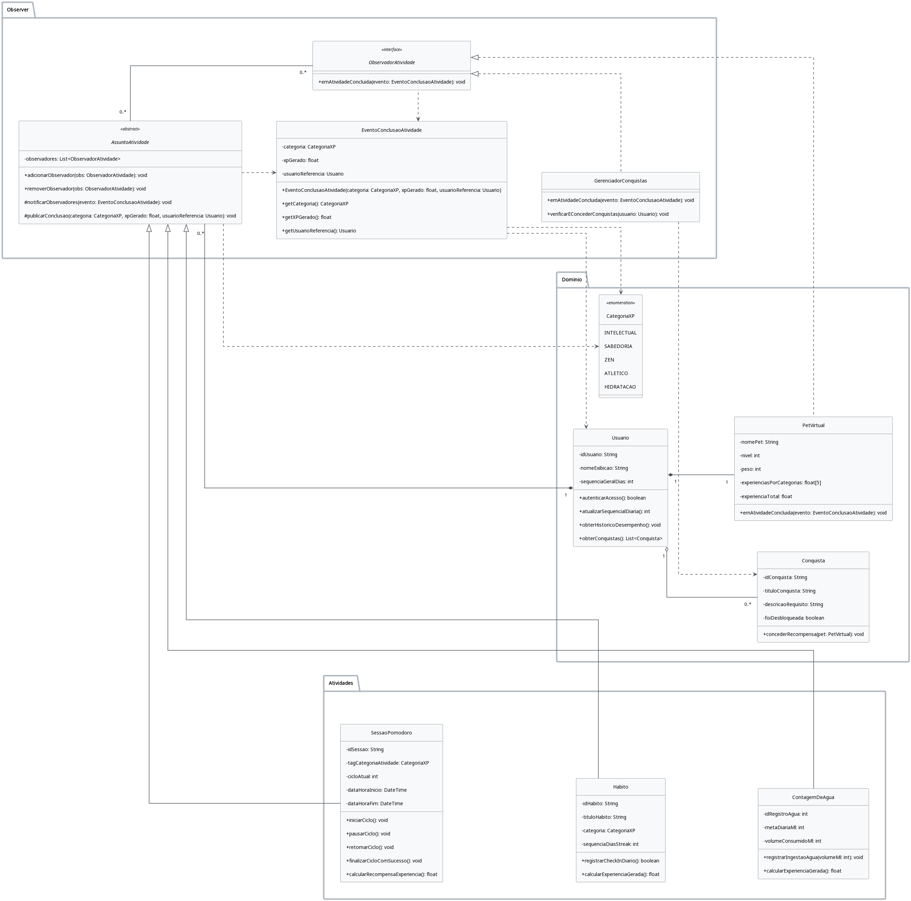
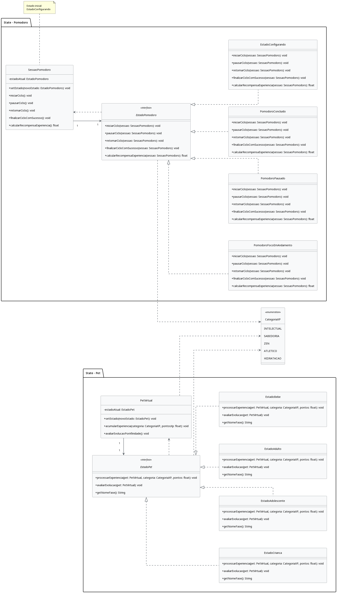

# Evidências · Subgrupo 03 · Padrões Comportamentais

<strong>Entrega 03 · FOCO_03 · Padrões Comportamentais</strong>
Esta página está preparada para receber comprobatórios desta entrega. Ainda não há evidências registradas.

  <a class="member-card" href="https://github.com/artmendess" target="_blank">
        
        <strong>Arthur Mendes Borges</strong>
        241010914
        <small>@artmendess</small>
      </a>
  <a class="member-card" href="https://github.com/vevetin" target="_blank">
        
        <strong>Weverton Rodrigues da Costa Silva</strong>
        221022767
        <small>@vevetin</small>
      </a>
  <a class="member-card" href="https://github.com/Pabloo8" target="_blank">
        
        <strong>Pablo Cunha de Jesus</strong>
        222014910
        <small>@Pabloo8</small>
      </a>

## Reuniões e metodologia

### Reunião 1 – Refinamento dos diagramas e discussão de padrões de projeto

Em 17 de outubro de 2026, às 11h24, Weverton Rodrigues e Pablo Cunha, do SubGrupo 03 do projeto G4 - Projeto Jogo, reuniram-se pelo Google Meet para revisar os diagramas de classes da subentrega anterior, discutir padrões de projeto e avaliar a padronização das tecnologias entre os subgrupos.

Weverton explicou o uso dos padrões Observer e State no projeto. O Observer foi discutido para organizar a comunicação entre atividades, como contagem de água, hábitos e sessões Pomodoro, e os componentes que atualizam os dados do usuário e o histórico. O State foi abordado na implementação dos estados do temporizador Pomodoro e das fases de desenvolvimento do pet.

Pablo iniciou a revisão de seu diagrama de classes com base no parecer da professora. Os integrantes utilizaram o Visual Studio Code, o Live Share e o PlantUML para elaborar e discutir os diagramas em conjunto.

Também foram consideradas alternativas para o desenvolvimento do jogo, como Unity, Godot ou tecnologias voltadas à linguagem de programação escolhida. A definição de uma linguagem e de uma engine comuns aos três subgrupos ficou pendente de decisão coletiva.

 [Link da gravação](https://www.youtube.com/watch?v=NUetBOdRjwM)

  <iframe
  width="560"
  height="315"
  src="https://www.youtube.com/embed/NUetBOdRjwM"
  title="Reunião 17/10/2026 (SubGrupo 03)"
  frameborder="0"
  allow="accelerometer; autoplay; clipboard-write; encrypted-media; gyroscope; picture-in-picture; web-share"
  allowfullscreen>
</iframe>

<a href="Base/assets/subEquipe03/observacao.pdf" target="_blank" rel="noopener">
  Observações da reunião (ata) — documento gerado pelo Google Meet
</a>
 
<a href="Base/assets/subEquipe03/transcricao.pdf" target="_blank" rel="noopener">
  Transcrição da reunião — documento gerado pelo Google Meet
</a>

### Atas de reuniões

<table>
  <thead>
    <tr>
      <th>Reunião</th>
      <th>Resumo</th>
      <th>Ata</th>
    </tr>
  </thead>
  <tbody>
    <tr>
  <td>Reunião 17/10/2026 (SubGrupo 03)</td>
  <td>Refinamento do Diagrama de Classes com PlantUML, discussão da aplicação dos padrões Observer e State e análise de tecnologias e engines para o desenvolvimento do jogo.</td>
  <td><label class="ata-link" for="ata-0">Abrir ata</label></td>
</tr>
  </tbody>
</table>

<input class="ata-toggle" type="checkbox" id="ata-0">

  <label class="ata-modal-backdrop" for="ata-0"></label>
  <section class="ata-modal-content" aria-labelledby="ata-0-title">
    <label class="ata-modal-close" for="ata-0" aria-label="Fechar ata">x</label>
    <h3 id="ata-0-title">Ata - Reunião 17/10/2026 (SubGrupo 03)</h3>
    
<strong>Projeto:</strong> G4 - Projeto Jogo

    
<strong>Disciplina:</strong> Arquitetura e Desenho de Software

    
<strong>Participantes:</strong> Weverton Rodrigues e Pablo Cunha.

    
<strong>Pauta:</strong> refinamento do Diagrama de Classes, discussão da aplicação dos padrões de projeto Observer e State e alinhamento sobre a padronização da linguagem de programação e da engine do projeto.

    
<strong>Resumo:</strong> a reunião foi dedicada ao refinamento dos diagramas de classes e à discussão da aplicação dos padrões comportamentais Observer e State no projeto. Pablo Cunha relatou que iniciaria a revisão do diagrama de classes de sua subentrega, considerando as observações do parecer da professora, e que pretendia utilizar o PlantUML para gerar uma nova versão. Weverton apresentou ferramentas de apoio à modelagem e ao desenvolvimento colaborativo no Visual Studio Code, incluindo o Live Share, e auxiliou Pablo na configuração do ambiente. Durante a reunião, foram discutidas as relações entre classes, a representação de interfaces, classes abstratas e enumerações no PlantUML, além da aplicação do padrão Observer para centralizar notificações de eventos relacionados à contagem de água, hábitos e sessões de Pomodoro. Também foi abordado o padrão State para desacoplar a lógica dos estados da sessão de Pomodoro e permitir diferentes cálculos de experiência (XP) conforme a fase de desenvolvimento do pet. Por fim, os participantes discutiram a necessidade de padronizar a linguagem de programação entre os três subgrupos e avaliar o uso de engines como Unity e Godot ou tecnologias web com JavaScript. A escolha definitiva da linguagem e da engine permaneceu pendente de decisão conjunta.

    
<strong>Encaminhamentos:</strong> Pablo Cunha deverá refinar o Diagrama de Classes de sua subentrega com base nas observações do parecer da professora e gerar uma nova versão utilizando PlantUML. Também deverá estudar materiais e exemplos sobre o padrão State para iniciar sua implementação e esclarecer eventuais dúvidas com Weverton. O grupo deverá definir a linguagem de programação e a engine que serão utilizadas pelos subgrupos, considerando o reaproveitamento do código na entrega final e a necessidade de evidenciar a implementação dos padrões de projeto.

    
<strong>Artefatos abordados:</strong> Diagrama de Classes UML, Diagramas de Estados, padrões Observer e State, PlantUML, Visual Studio Code e Live Share.

  </section>

## Modelo e decisão

<strong>Diagrama UML e rastro</strong>
Inserir imagem ou link para o modelo, fonte, data, versão e relação com a seção de modelagem do relatório.

| Padrão / papel | Requisito ou problema relacionado | Decisão documentada | Link da evidência |
|---|---|---|---|
| A preencher | A preencher | A preencher | A preencher |

## Código e execução

| Trecho ou componente | Link para código | Vídeo do padrão em execução | Versão ou commit |
|---|---|---|---|
| A preencher | A preencher | A preencher | A preencher |

## IA generativa e senso crítico

A utilização de ferramentas de Inteligência Artificial Generativa ao longo desta etapa ocorreu como recurso de apoio à equipe, principalmente durante a consulta sobre padrões de projeto comportamentais e sua aplicação na arquitetura do sistema. O uso da ferramenta concentrou-se no esclarecimento de dúvidas sobre os Padrões Comportamentais GoF na revisão dos diagramas de classes em PlantUML e no apoio à estruturação das respectivas implementações em Java.

Os conteúdos gerados foram utilizados como material de apoio e submetidos à análise crítica da equipe. As sugestões e estruturas produzidas pela IA foram revisadas, ajustadas manualmente e adaptadas às decisões de modelagem e aos requisitos do sistema. Dessa forma, os materiais gerados pela ferramenta não substituíram a análise e as decisões da equipe, servindo como apoio durante o processo de construção, implementação e revisão dos artefatos apresentados neste relatório.

| Material | Descrição | Links | Autor |
|---|---|---|---|
| `diagrama-observer.plantuml` | Código-fonte PlantUML do diagrama de classes do padrão comportamental Observer, utilizado para representar a relação entre o sujeito observado e seus observadores no projeto. | <a href="Base/assets/subEquipe03/diagrama-observer.plantuml" download>Baixar arquivo .plantml</a> /  |[Weverton Rodrigues](https://github.com/vevetin)|
| `diagrama-state.plantuml` | Código-fonte PlantUML do diagrama de classes do padrão comportamental State, utilizado para representar os estados de uma sessão e as transições entre eles. |  <a href="Base/assets/subEquipe03/diagrama-state.plantuml" download>Baixar arquivo .plantml</a> /  | [Weverton Rodrigues](https://github.com/vevetin) |
| `observer+state.plantuml` | Código-fonte PlantUML do diagrama integrado dos padrões Observer e State, demonstrando como os padrões se relacionam na arquitetura do projeto. | <a href="Base/assets/subEquipe03/observer+state.plantuml" download>Baixar arquivo .plantml</a> | [Weverton Rodrigues](https://github.com/vevetin) |
