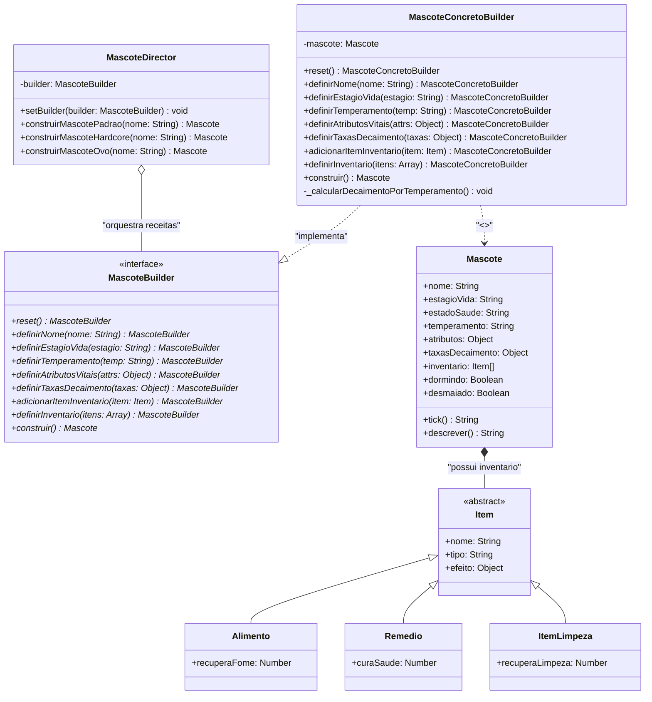
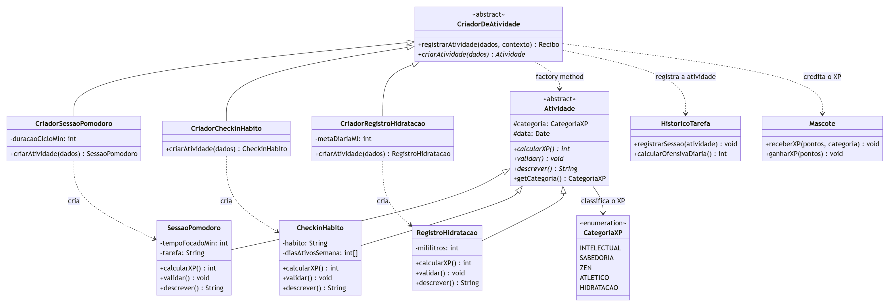
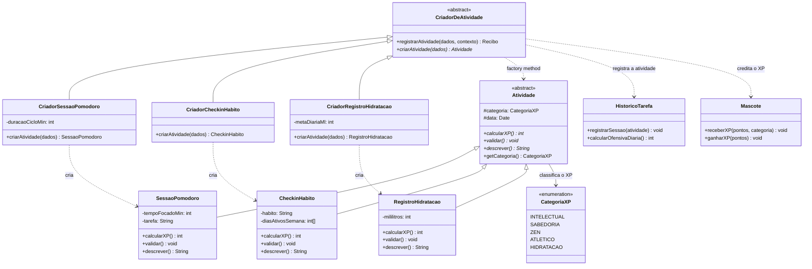

# Subgrupo 02 — Padrões Criacionais

<div class="delivery-lead">
  <strong>Entrega 03 · Subgrupo 02 · Padrões Criacionais</strong>
  <p>Roteiro de preenchimento do FOCO_01: padrão GoF Criacional e uso crítico de IA generativa.</p>
</div>

<div class="members-grid" aria-label="Integrantes do Subgrupo 02">
  <a class="member-card" href="https://github.com/luabrantess" target="_blank">
        
        <strong>Ana Luiza Borba de Abrantes</strong>
        <span>200014226</span>
        <small>@luabrantess</small>
      </a>
  <a class="member-card" href="https://github.com/auslogyc" target="_blank">
        
        <strong>Danilo Sarmento Barros</strong>
        <span>222008468</span>
        <small>@auslogyc</small>
      </a>
  <a class="member-card" href="https://github.com/jvopBR" target="_blank">
        
        <strong>João Vitor Mendonça Merlin</strong>
        <span>222006848</span>
        <small>@jvopBR</small>
      </a>
</div>

O relatório a seguir consolida a continuidade da evolução arquitetural do **G4_ProjetoJogo (Mascote Virtual & Pomodoro)**, estabelecendo rastreabilidade direta entre o modelo de processos da **Entrega 01 (BPMN)**, os modelos estáticos e dinâmicos da **Entrega 02 (Diagrama de Classes v2 e Diagrama de Estados do Mascote)** e a implementação formal de dois padrões de projeto criacionais nesta **Entrega 03**: o **GoF Builder (Construtor)**, que monta o mascote, e o **GoF Factory Method (Método Fábrica)**, que cria as atividades que geram XP para esse mascote.

---

## Foco do Relatório:
### FOCO_01: GoFs Criacionais & IA Generativa

### Metodologia do Foco_01

O desenvolvimento do trabalho foi organizado em três etapas principais, com o objetivo de promover o alinhamento da equipe, distribuir as responsabilidades e validar os resultados obtidos.

##### 1. Reunião de alinhamento e divisão de funções

No dia 16 de outubro, começamos realizando uma reunião para discutir os objetivos do trabalho, alinhar as expectativas dos integrantes e definir a divisão de tarefas. Buscamos garantir uma execução organizada, colaborativa e coerente com os objetivos estabelecidos. Durante a reunião, foram definidos os papéis e as responsabilidades de cada integrante, permitindo que todos compreendessem suas atribuições e contribuíssem para o desenvolvimento do projeto.

##### 2. Desenvolvimento assíncrono

Após a reunião inicial, o trabalho prosseguiu de forma assíncrona, com cada integrante realizando as atividades pelas quais ficou responsável. Essa etapa permitiu que os membros desenvolvessem suas tarefas individualmente, respeitando a divisão estabelecida e contribuindo para a construção do resultado coletivo. Ao longo do processo, as atividades foram realizadas com base nas decisões e nos alinhamentos definidos anteriormente.

##### 3. Reunião de entrega e validação

Por fim, realizamos uma reunião de entrega com o objetivo de apresentar, revisar e validar o trabalho desenvolvido pela equipe. Nesse momento, verificamos as atividades realizadas, avaliamos se os resultados estavam de acordo com os objetivos propostos e discutimos os ajustes necessários. Após a análise conjunta, o trabalho foi aprovado pelos integrantes, concluindo o processo de desenvolvimento e validação.

##### Registros e evidências do trabalho em equipe

Para documentar o processo de colaboração, disponibilizamos a ata da reunião realizada em 16 de outubro e a gravação do encontro. Esses registros permitem acompanhar o alinhamento inicial, a organização das responsabilidades e as decisões tomadas pela equipe durante o desenvolvimento do trabalho.

<div class="fill-slot">
<strong>Processo de trabalho</strong>
<p><strong>Ata da reunião — 16 de outubro:</strong> <a href="https://docs.google.com/document/d/1lDWAN8DdjadWiJ-RB9OFo-aBXEpLoBgjMIy3uH0KpBs/edit?usp=sharing">Acessar ata</a></p>
<p><strong>Gravação da reunião:</strong> <a href="LINK_DA_GRAVACAO">Assistir à gravação</a></p>
<p><em>Os registros documentam as reuniões, a divisão de funções, as decisões e a validação do trabalho realizado pela equipe.</em></p>
</div>

* **Atuação de Danilo Sarmento Barros:** Como continuidade direta de sua contribuição na **Entrega 02** (na qual elaborou o *Diagrama de Classes v2* com especialização de itens e validou os Casos de Uso), Danilo assumiu a responsabilidade de materializar o padrão GoF Criacional **Builder** em código-fonte executável (`tamagotchi_builder.js`). Projetou a arquitetura dos participantes (`Mascote`, `MascoteBuilder`, `MascoteConcretoBuilder`, `MascoteDirector`), integrou os itens especializados de inventário (`Alimento`, `Remedio`, `ItemLimpeza`), desenvolveu a suíte de demonstração em tempo real com simulação de *ticks* e documentou a rastreabilidade técnica e a análise crítica de IA Generativa.

* **Atuação de João Vitor Mendonça Merlin:** Dando continuidade aos modelos dinâmicos que elaborou na **Entrega 02** (*Diagrama de Estados do Mascote* e *Diagrama de Sequência* da sessão Pomodoro), João Vitor assumiu o segundo padrão criacional do subgrupo, o **Factory Method**, responsável pela criação das atividades que geram XP (`SessaoPomodoro`, `CheckinHabito` e `RegistroHidratacao`). Modelou o diagrama de classes do padrão, implementou o código executável (`factory_method_atividades.js`) com as validações das regras RN01, RN02 e RN03 e documentou a rastreabilidade com os requisitos e com os diagramas das entregas anteriores.

---

### GoF Criacional: Builder (Construtor)

#### Contexto (Problema)
Descrever o contexto, apresentando o problema a ser resolvido com o padrão desejado.

Na **Entrega 02**, o domínio do sistema foi estruturado para unir a mecânica de produtividade (Sessões Pomodoro) aos cuidados de um bichinho virtual (*Mascote*). O **Diagrama de Classes v2** definiu que a entidade `Mascote` possui uma estrutura rica, composta por:
1. **Identificação e Ciclo de Vida:** `nome`, `estagioVida` (`FILHOTE`, `JOVEM`, `ADULTO`) e `estadoSaude` (`SAUDAVEL`, `FAMINTO`, `SUJO`, `DOENTE`), conforme modelado no *Diagrama de Estados do Mascote* da Entrega 02;
2. **Atributos Vitais:** Vetor de necessidades contínuas (`fome`, `sujeira`, `saude`), inicializado no padrão canônico `80/80/100/100/80` (rastreado desde a `Task_S_InicializaPet` da Entrega 01);
3. **Taxas de Decaimento por Tick:** Velocidade de redução contínua de cada atributo a cada segundo (`SubProcess_S_Tick`), ajustada dinamicamente pelo `temperamento` do pet (`EQUILIBRADO`, `COMILAO`, `BRINCALHAO`, `PREGUICOSO`);
4. **Inventário Inicial de Itens Especializados:** Instâncias de classes polimórficas derivadas da classe abstrata `Item` (`Alimento`, `Remedio`, `ItemLimpeza`), conforme modelado na especialização de itens da Entrega 02.

**O Problema Arquitetural:**  
Instanciar esse `Mascote` diretamente através de construtores tradicionais gerava o clássico antipadrão do **Construtor Telescópico** (*telescoping constructor*):
```javascript
// Antipadrão: fragilidade posicional, código ilegível e propenso a falhas
const pet = new Mascote("Tama", "FILHOTE", "EQUILIBRADO", 80, 80, 100, 100, 80, 1.0, 0.8, 0.5, 0.7, [item1, item2]);
```
Além de tornar o código frágil e dificultar a adição de novas características, esse acoplamento impedia que o sistema reutilizasse algoritmos padronizados de criação (para diferentes modos de jogo) e oferecesse uma API flexível para que o jogador pudesse customizar seu próprio pet.

**Decisão e Papel do Padrão Builder:**  
O padrão **Builder** (Gamma et al., 1994) resolve este problema ao isolar a lógica de montagem complexa da representação do objeto. Com o padrão:
- O **`MascoteDirector`** atua como o orquestrador das configurações canônicas do jogo:
  - *Mascote Padrão:* Garante a conformidade estrita com o BPMN (`80/80/100/100/80`, estágio `FILHOTE` e inventário balanceado com `Alimento`, `Remedio` e `ItemLimpeza`).
  - *Mascote Hardcore:* Gera uma experiência desafiadora com atributos reduzidos e decaimento acelerado.
  - *Mascote Ovo:* Inicializa o estado embrionário recém-chocado.
- O **`MascoteConcretoBuilder`** provê uma interface fluente encadeada com validações defensivas (*clamp* numérico entre 0 e 100 e validação de tipos de itens), garantindo integridade antes de entregar a instância pelo método `construir()`.

---

#### Modelagem (Notação UML)

A modelagem UML apresentada representa a estrutura estática do projeto, utilizando um diagrama de classes para demonstrar a organização dos componentes e seus relacionamentos. O diagrama destaca a implementação do padrão de projeto Builder, utilizado para construir mascotes de diferentes configurações de maneira organizada e flexível.

O `MascoteDirector` é responsável por coordenar a construção dos mascotes, definindo receitas específicas, como o mascote padrão, hardcore e ovo. Para isso, utiliza a interface MascoteBuilder, que estabelece os métodos necessários para configurar cada característica do mascote.

A classe `MascoteConcretoBuilder` implementa essa interface e realiza a construção efetiva do objeto Mascote, definindo seu nome, estágio de vida, temperamento, atributos vitais, taxas de decaimento e inventário. Essa separação permite modificar o processo de construção sem alterar a estrutura principal do mascote.

O diagrama também apresenta a classe abstrata `Item` e suas especializações: `Alimento`, `Remedio` e `ItemLimpeza`. Essa hierarquia permite representar diferentes tipos de itens, cada um com seus próprios efeitos. A relação de composição entre Mascote e Item indica que o inventário faz parte da estrutura do mascote.

Dessa forma, a modelagem evidencia como o padrão Builder contribui para a organização do código, a reutilização de componentes e a flexibilidade na criação de mascotes, enquanto a hierarquia de itens facilita a representação dos recursos disponíveis no projeto.




*Figura 1: Diagrama de Classes UML do Padrão Builder integrado à hierarquia de Itens da Entrega 02.*  
*Fonte: Subgrupo 02 (2026), baseado nas convenções de Gamma et al. (1994).*

---

#### Implementação (Código & Vídeo com Padrão em Execução)
*Responsável pela implementação e testes: Danilo Sarmento Barros*

Explicar cada trecho de código, inerente aos participantes do padrão.  
Conferir um link para o código hospedado no repositório do projeto.  
Acordar um vídeo, demonstrando o código em execução.

##### 1. Hierarquia de Itens Especializados (Rastreabilidade com Entrega 02)
Resgata a modelagem estática desenvolvida por Danilo na Entrega 02, permitindo que o Builder injete instâncias concretas e tipadas no inventário do pet.

```javascript
class Item {
    constructor(nome, tipo, efeito) {
        this.nome = nome;
        this.tipo = tipo; // 'ALIMENTO', 'REMEDIO', 'LIMPEZA'
        this.efeito = efeito;
    }
}

class Alimento extends Item {
    constructor(nome, recuperaFome, bonusFelicidade = 5) {
        super(nome, 'ALIMENTO', { fome: recuperaFome, felicidade: bonusFelicidade });
    }
}

class Remedio extends Item {
    constructor(nome, curaSaude = 30) {
        super(nome, 'REMEDIO', { saude: curaSaude });
    }
}

class ItemLimpeza extends Item {
    constructor(nome, recuperaLimpeza = 40) {
        super(nome, 'LIMPEZA', { limpeza: recuperaLimpeza });
    }
}
```

##### 2. Produto Complexo (`Mascote`)
Incorpora a máquina de estados de saúde da Entrega 02 (`SAUDAVEL`, `FAMINTO`, `SUJO`) e o loop de decaimento em tempo real da Entrega 01 (`tick()`).

```javascript
class Mascote {
    constructor() {
        this.nome = 'Mascote Sem Nome';
        this.estagioVida = 'FILHOTE';
        this.estadoSaude = 'SAUDAVEL';
        this.temperamento = 'EQUILIBRADO';
        this.atributos = { fome: 80, felicidade: 80, energia: 100, limpeza: 100, saude: 80 };
        this.taxasDecaimento = { fome: 1.0, felicidade: 0.8, energia: 0.5, limpeza: 0.7 };
        this.inventario = [];
        this.desmaiado = false;
        this.dormindo = false;
    }

    tick() {
        if (this.desmaiado) return `[ALERTA] ${this.nome} desmaiado! Pressione A para reviver.`;
        this.atributos.fome = Math.max(0, +(this.atributos.fome - this.taxasDecaimento.fome).toFixed(1));
        this.atributos.felicidade = Math.max(0, +(this.atributos.felicidade - this.taxasDecaimento.felicidade).toFixed(1));
        this.atributos.limpeza = Math.max(0, +(this.atributos.limpeza - this.taxasDecaimento.limpeza).toFixed(1));
        
        // Atualização reativa do estado de saúde (Diagrama de Estados da Entrega 02)
        if (this.atributos.fome < 20) this.estadoSaude = 'FAMINTA';
        else if (this.atributos.limpeza < 20) this.estadoSaude = 'SUJA';
        else if (this.atributos.saude < 30) this.estadoSaude = 'DOENTE';
        else this.estadoSaude = 'SAUDAVEL';

        return `Tick: Fome=${this.atributos.fome}% | Felicidade=${this.atributos.felicidade}% | Saúde=${this.atributos.saude}% [${this.estadoSaude}]`;
    }
}
```

##### 3. Interface Abstrata (`MascoteBuilder`)
Estabelece o contrato com cada etapa de personalização do mascote.

```javascript
class MascoteBuilder {
    reset() { throw new Error('reset() deve ser implementado'); }
    definirNome(nome) { throw new Error('definirNome() deve ser implementado'); }
    definirEstagioVida(estagio) { throw new Error('definirEstagioVida() deve ser implementado'); }
    definirTemperamento(temperamento) { throw new Error('definirTemperamento() deve ser implementado'); }
    definirAtributosVitais(atributos) { throw new Error('definirAtributosVitais() deve ser implementado'); }
    definirTaxasDecaimento(taxas) { throw new Error('definirTaxasDecaimento() deve ser implementado'); }
    definirInventario(itens) { throw new Error('definirInventario() deve ser implementado'); }
    construir() { throw new Error('construir() deve ser implementado'); }
}
```

##### 4. Construtor Concreto (`MascoteConcretoBuilder`)
Implementa o encadeamento fluente com programação defensiva: delimita atributos numéricos entre 0 e 100 via *clamp*, valida tipos de itens no inventário e calcula as taxas de decaimento por temperamento.

```javascript
class MascoteConcretoBuilder extends MascoteBuilder {
    constructor() {
        super();
        this.reset();
    }

    reset() {
        this.mascote = new Mascote();
        return this;
    }

    definirNome(nome) {
        if (!nome || nome.trim() === '') throw new Error('Nome do mascote é obrigatório.');
        this.mascote.nome = nome.trim();
        return this;
    }

    definirAtributosVitais(atributos) {
        const clamp = (val, padrao) => Math.max(0, Math.min(100, Number(val ?? padrao)));
        this.mascote.atributos = {
            fome: clamp(atributos.fome, 80),
            felicidade: clamp(atributos.felicidade, 80),
            energia: clamp(atributos.energia, 100),
            limpeza: clamp(atributos.limpeza, 100),
            saude: clamp(atributos.saude, 80)
        };
        return this;
    }

    _calcularDecaimentoPorTemperamento() {
        switch (this.mascote.temperamento) {
            case 'COMILAO':    this.mascote.taxasDecaimento = { fome: 1.8, felicidade: 0.8, energia: 0.5, limpeza: 0.8 }; break;
            case 'BRINCALHAO': this.mascote.taxasDecaimento = { fome: 1.0, felicidade: 1.6, energia: 0.9, limpeza: 0.9 }; break;
            case 'PREGUICOSO': this.mascote.taxasDecaimento = { fome: 0.8, felicidade: 0.7, energia: 1.3, limpeza: 0.5 }; break;
            default:           this.mascote.taxasDecaimento = { fome: 1.0, felicidade: 0.8, energia: 0.5, limpeza: 0.7 }; break;
        }
    }

    construir() {
        if (!this.mascote.taxasDecaimento) this._calcularDecaimentoPorTemperamento();
        const produto = this.mascote;
        this.reset();
        return produto;
    }
}
```

##### 5. Diretor de Montagem (`MascoteDirector`)
Reúne as montagens predefinidas canônicas para o jogo, garantindo rastreabilidade com as regras do BPMN.

```javascript
class MascoteDirector {
    constructor(builder) { this.builder = builder; }

    construirMascotePadrao(nome) {
        return this.builder
            .reset()
            .definirNome(nome)
            .definirEstagioVida('FILHOTE')
            .definirTemperamento('EQUILIBRADO')
            .definirAtributosVitais({ fome: 80, felicidade: 80, energia: 100, limpeza: 100, saude: 80 })
            .definirTaxasDecaimento({ fome: 1.0, felicidade: 0.8, energia: 0.5, limpeza: 0.7 })
            .definirInventario([
                new Alimento('Maçã Pomodoro', 25, 10),
                new Remedio('Pílula de Foco', 30),
                new ItemLimpeza('Sabonete Anti-Distração', 40)
            ])
            .construir();
    }
}
```

* **Arquivo com Código Completo:** [tamagotchi_builder.js](https://github.com/UnBArqDsw2026-2-Turma02/2026.2-T02-_G4_ProjetoJogo_Entrega_03/blob/subgrupo02/docs/Base/Relat%C3%B3rios/tamagotchi_builder.js)
* **Vídeo do Padrão em Execução:** *(Link para o vídeo demonstrando a execução)*

---

#### Rastreabilidade do padrão

| Requisito / Artefato Anterior | Decisão e Papel do Padrão Builder | Modelo UML | Código-Fonte | Evidência de Execução |
|---|---|---|---|---|
| **BPMN Entrega 01:** Inicialização clássica (`Task_S_InicializaPet`: 80/80/100/100/80). | Centralização das regras oficiais no método `construirMascotePadrao()` do Director. | Associação entre `MascoteDirector` e `MascoteBuilder`. | Método `construirMascotePadrao()` em `MascoteDirector`. | Saída no console: `[1] Construção via Director: Mascote Padrão (Entrega 01/02)` com atributos 80/80/100/100/80. |
| **Diagrama de Classes v2 (Entrega 02):** Especialização de itens (`Alimento`, `Remedio`, `ItemLimpeza`). | O Builder valida e injeta instâncias polimórficas de `Item` no inventário inicial do mascote. | Herança `Item <|-- Alimento/Remedio/ItemLimpeza` e agregação com `Mascote`. | Classes especializadas de itens e método `definirInventario()`. | Cartão de status exibindo inventário inicial com Maçã Pomodoro, Pílula de Foco e Sabonete. |
| **Diagrama de Estados (Entrega 02):** Ciclo de vida (`FILHOTE`, `JOVEM`, `ADULTO`) e saúde (`SAUDAVEL`, `FAMINTA`, `SUJA`, `DOENTE`). | O Builder configura o estágio inicial e parametriza as taxas que provocam as transições de saúde no método `tick()`. | Atributos `estagioVida` e `estadoSaude` na classe `Mascote`. | Lógica de transição reativa dentro do método `tick()`. | Saída de simulação de 3 ticks demonstrando transição e exibição de `[Estado: SAUDAVEL]`. |
| **Prevenção de Falhas Arquiteturais:** Eliminação do Construtor Telescópico e parâmetros soltos. | Construção passo a passo encadeada com validação de limites (*clamp* de 0 a 100). | Interface `MascoteBuilder` e implementação `MascoteConcretoBuilder`. | Validação defensiva no método `definirAtributosVitais()` e `construir()`. | Mascote customizado criado com integridade total via interface fluente. |

---

### GoF Criacional: Factory Method (Método Fábrica)
*Responsável pela modelagem e implementação: João Vitor Mendonça Merlin*

#### Contexto (Problema)

O Builder resolve a montagem de **um** objeto complexo, o `Mascote`. O problema tratado aqui é o que acontece **depois**: quando o usuário conclui alguma coisa no aplicativo e isso precisa virar XP para esse mascote.

O **Diagrama de Sequência da Entrega 02** (*Sessão Pomodoro concluída → XP → Evolução do Mascote*) modelou um único caminho: `iniciarSessaoEstudo()` → `finalizarPomodoro()` → `registrarSessao()` → `ganharXP()`. A lista de requisitos, porém, prevê **três fontes de XP diferentes**, todas terminando no mesmo lugar:

| Fonte de XP | Requisitos | Regra de cálculo (RN01) |
|---|---|---|
| Sessão Pomodoro concluída | RF01, RF03 | ciclo de 25 min concluído = +50 XP na categoria da tarefa |
| Check-in de hábito | RF05, RF07, RF09 | credita XP na categoria do hábito e incrementa a sequência |
| Registro de hidratação | RF06 | cada 250 ml creditam XP na categoria `HIDRATACAO` |

Cada fonte nasce de dados diferentes (minutos focados; hábito e dias ativos; mililitros), tem **validação própria** (a RN01 exige o ciclo completo; a RN03 só aceita check-in em dia ativo) e calcula o XP de um jeito distinto. O que **não** muda é o fluxo seguinte: validar → calcular o XP → registrar no histórico (RF03, RF08) → creditar no vetor de cinco posições do mascote (RF11, RN02) → e, ao cruzar o limiar, disparar a evolução do `estagioVida` modelada no *Diagrama de Estados*.

**O problema arquitetural:**
Sem um padrão, esse fluxo vira um condicional espalhado pela camada de aplicação, com o trecho comum duplicado em cada ramo:

```javascript
// Antipadrão: fluxo repetido e um condicional que cresce a cada nova fonte de XP
if (tipo === 'POMODORO')    { validaPomodoro(d); xp = ...; historico.registrar(d); mascote.ganharXP(xp); }
else if (tipo === 'HABITO') { validaHabito(d);   xp = ...; historico.registrar(d); mascote.ganharXP(xp); }
else if (tipo === 'AGUA')   { validaAgua(d);     xp = ...; historico.registrar(d); mascote.ganharXP(xp); }
```

Cada nova fonte de XP (leitura, exercício, meditação) obriga a **editar um código que já funciona**, violando o princípio aberto/fechado e espalhando as regras RN01 e RN02 por vários pontos do sistema.

**Decisão e papel do Factory Method:**
O padrão **Factory Method** (GAMMA et al., 1994) declara uma operação de criação na superclasse e deixa que as subclasses decidam qual classe concreta instanciar. Aplicado ao projeto:

- **`CriadorDeAtividade`** (*Creator*) concentra o fluxo invariante no método `registrarAtividade()` e declara o factory method `criarAtividade()`;
- **`CriadorSessaoPomodoro`**, **`CriadorCheckinHabito`** e **`CriadorRegistroHidratacao`** (*ConcreteCreators*) respondem apenas **qual** atividade criar;
- **`Atividade`** (*Product*) padroniza `validar()`, `calcularXP()` e `getCategoria()`, de modo que o criador trate qualquer fonte de XP pelo mesmo contrato.

Incluir uma nova fonte de XP passa a ser criar um par Produto + Criador, **sem tocar** no fluxo já testado.

**Senso crítico — por que não o Builder, nem uma fábrica simples?**

- O **Builder** da seção anterior resolve *como montar* um objeto com muitos parâmetros opcionais. Aqui existem três produtos **diferentes** e simples, e o que varia é *qual* deles criar: o problema que o Factory Method endereça. Os dois padrões são complementares e atuam em momentos distintos do ciclo de vida do mascote.
- Uma **fábrica simples** (um `switch` dentro de um único método de criação) reduziria o acoplamento imediato, mas não é um padrão GoF e preserva o ponto único que precisa ser editado a cada novo tipo.
- **Abstract Factory** seria excessivo: não há famílias de produtos relacionados para criar em conjunto, e sim um produto por operação.

#### Modelagem (Notação UML)

<figure class="state-diagram">



<figcaption><strong>Figura 2:</strong> Diagrama de Classes do padrão Factory Method aplicado às atividades que geram XP, com os papéis <em>Creator</em>, <em>ConcreteCreator</em>, <em>Product</em> e <em>ConcreteProduct</em> e os colaboradores <code>HistoricoTarefa</code>, <code>Mascote</code> e <code>CategoriaXP</code> herdados da Entrega 02.<br><strong>Fonte:</strong> <a href="https://github.com/jvopBR" target="_blank">João Vitor Mendonça Merlin</a>, 2026, com base em Gamma et al. (1994).</figcaption>
</figure>

<details class="diagram-source">
<summary>Código-fonte Mermaid do diagrama</summary>



</details>

| Papel no padrão (GoF) | Classe no projeto |
|---|---|
| *Product* | `Atividade` (abstrata) |
| *ConcreteProduct* | `SessaoPomodoro`, `CheckinHabito`, `RegistroHidratacao` |
| *Creator* | `CriadorDeAtividade` (declara `criarAtividade()`) |
| *ConcreteCreator* | `CriadorSessaoPomodoro`, `CriadorCheckinHabito`, `CriadorRegistroHidratacao` |

#### Implementação (Código & Vídeo com Padrão em Execução)
*Responsável pela implementação e testes: João Vitor Mendonça Merlin*

##### 1. Categorias de XP e o Produto abstrato (`Atividade`)
O enum reproduz a **RN02**: o valor de cada categoria é o índice dela no vetor de cinco posições do mascote. A classe `Atividade` é o contrato que o criador enxerga, com os três pontos que variam entre as fontes de XP.

```javascript
const CategoriaXP = Object.freeze({
  INTELECTUAL: 0, SABEDORIA: 1, ZEN: 2, ATLETICO: 3, HIDRATACAO: 4
});

class Atividade {
  constructor(categoria, data = new Date()) {
    if (new.target === Atividade) {
      throw new Error('Atividade é abstrata: instancie uma atividade concreta.');
    }
    if (!Object.values(CategoriaXP).includes(categoria)) {
      throw new Error('Categoria de XP inválida (RN02).');
    }
    this.categoria = categoria;
    this.data = data;
  }

  calcularXP() { throw new Error('calcularXP() deve ser implementado pela atividade concreta.'); }
  validar()    { throw new Error('validar() deve ser implementado pela atividade concreta.'); }
  descrever()  { throw new Error('descrever() deve ser implementado pela atividade concreta.'); }
}
```

##### 2. Produtos concretos: cada regra de XP no seu lugar
Cada produto traduz uma regra de negócio da Entrega 02. A `SessaoPomodoro` aplica a RN01 (um ciclo de 25 min equivale a +50 XP) e recusa sessões interrompidas; o `CheckinHabito` aplica a RN03, recusando check-in fora dos dias ativos.

```javascript
class SessaoPomodoro extends Atividade {
  static DURACAO_CICLO_MIN = 25;
  static XP_POR_CICLO = 50;

  validar() {
    if (!Number.isFinite(this.tempoFocadoMin) || this.tempoFocadoMin < this.duracaoCicloMin) {
      throw new Error(`Sessão não concluída: são necessários ao menos ${this.duracaoCicloMin} min de foco (RN01).`);
    }
    if (!this.tarefa) throw new Error('Sessão inválida: informe a tarefa associada (RF03).');
  }

  calcularXP() {
    const ciclos = Math.floor(this.tempoFocadoMin / this.duracaoCicloMin);
    return ciclos * SessaoPomodoro.XP_POR_CICLO;
  }
}

class CheckinHabito extends Atividade {
  static XP_POR_CHECKIN = 20; // RN01 credita XP pelo check-in, mas não fixa o valor

  validar() {
    if (!this.habito) throw new Error('Check-in inválido: informe o hábito (RF07).');
    if (!this.diasAtivosSemana.includes(this.diaDaSemana)) {
      throw new Error(`Check-in fora dos dias ativos do hábito "${this.habito}" (RN03).`);
    }
  }

  calcularXP() { return CheckinHabito.XP_POR_CHECKIN; }
}

class RegistroHidratacao extends Atividade {
  static COPO_ML = 250;        // RN01
  static XP_POR_COPO = 10;     // parâmetro acordado pela equipe

  calcularXP() {
    return Math.floor(this.mililitros / RegistroHidratacao.COPO_ML) * RegistroHidratacao.XP_POR_COPO;
  }
}
```

##### 3. Criador abstrato (`CriadorDeAtividade`) — o coração do padrão
`registrarAtividade()` é o fluxo que vale para qualquer fonte de XP e **não conhece nenhuma classe concreta**: ele chama o factory method e trabalha apenas pelo contrato de `Atividade`. É aqui que o padrão elimina a duplicação do condicional mostrado no contexto.

```javascript
class CriadorDeAtividade {
  /** Factory Method: cada criador concreto decide qual Atividade instanciar. */
  criarAtividade(dados) {
    throw new Error('criarAtividade() deve ser implementado pelo criador concreto.');
  }

  registrarAtividade(dados, { historico, mascote }) {
    const atividade = this.criarAtividade(dados); // ← único ponto de variação
    atividade.validar();

    const xp = atividade.calcularXP();
    historico.registrarSessao(atividade);          // RF03 e RF08
    mascote.receberXP(xp, atividade.getCategoria()); // RF11 e RN02

    return {
      atividade: atividade.descrever(),
      categoria: atividade.getNomeCategoria(),
      xp,
      ofensivaDiaria: historico.calcularOfensivaDiaria()
    };
  }
}
```

##### 4. Criadores concretos: a única coisa que cada tela precisa saber
Cada criador tem uma responsabilidade só, instanciar o seu produto. Note que **nenhum deles reimplementa o fluxo**: herdam `registrarAtividade()` do criador abstrato.

```javascript
class CriadorSessaoPomodoro extends CriadorDeAtividade {
  criarAtividade({ tempoFocadoMin, tarefa, categoria }) {
    return new SessaoPomodoro({ tempoFocadoMin, tarefa, categoria, duracaoCicloMin: this.duracaoCicloMin });
  }
}

class CriadorCheckinHabito extends CriadorDeAtividade {
  criarAtividade({ habito, categoria, diasAtivosSemana, diaDaSemana }) {
    return new CheckinHabito({ habito, categoria, diasAtivosSemana, diaDaSemana });
  }
}

class CriadorRegistroHidratacao extends CriadorDeAtividade {
  criarAtividade({ mililitros }) {
    return new RegistroHidratacao({ mililitros });
  }
}
```

##### 5. Execução: as três fontes de XP alimentando o mesmo mascote
A demonstração registra uma sessão Pomodoro, um check-in de hábito e um registro de hidratação, e ainda exercita as duas validações. Saída real do comando `node factory_method_atividades.js`:

```text
[1] Sessao Pomodoro (RF01/RN01)
    { atividade: 'Pomodoro de 50 min em "Arquitetura e Desenho de Software"',
      categoria: 'INTELECTUAL', xp: 100, ofensivaDiaria: 1 }

[2] Check-in de habito (RF05/RN03)
    { atividade: 'Check-in do hábito "Meditar 10 min"',
      categoria: 'ZEN', xp: 20, ofensivaDiaria: 1 }

[3] Registro de hidratacao (RF06/RN01)
   [EVOLUCAO] Tama: FILHOTE -> JOVEM (XP total 150)
    { atividade: 'Hidratação de 750 ml',
      categoria: 'HIDRATACAO', xp: 30, ofensivaDiaria: 1 }

[4] Validacao: sessao interrompida antes dos 25 min
    [REJEITADO] Sessão não concluída: são necessários ao menos 25 min de foco (RN01).

[5] Validacao: check-in em dia nao ativo do habito
    [REJEITADO] Check-in fora dos dias ativos do hábito "Correr" (RN03).

=== Estado final do mascote ===
    Vetor de XP por categoria: INTELECTUAL=100 | SABEDORIA=0 | ZEN=20 | ATLETICO=0 | HIDRATACAO=30
    XP total: 150 | Estagio de vida: JOVEM | Afinidade: INTELECTUAL
    Atividades no historico: 3 | Ofensiva diaria: 1
```

Repare no item **[3]**: ao somar 150 XP, o mascote cruzou o limiar e evoluiu de `FILHOTE` para `JOVEM`, exatamente a transição `ganharXP(pontos) / [acumulado >= limiar1]` da sub-máquina de evolução modelada no *Diagrama de Estados* da Entrega 02. O vetor final também comprova a RN02: cada atividade creditou XP na posição correta da sua categoria.

* **Arquivo com Código Completo:** [factory_method_atividades.js](https://github.com/UnBArqDsw2026-2-Turma02/2026.2-T02-_G4_ProjetoJogo_Entrega_03/blob/main/docs/Base/Relat%C3%B3rios/factory_method_atividades.js)
* **Vídeo do Padrão em Execução:** *(Link para o vídeo demonstrando a execução)*

#### Rastreabilidade do padrão

| Requisito / Artefato Anterior | Decisão e Papel do Factory Method | Modelo UML | Código-Fonte | Evidência de Execução |
|---|---|---|---|---|
| **Diagrama de Sequência (Entrega 02):** `iniciarSessaoEstudo()` → `registrarSessao()` → `ganharXP()`. | O fluxo da sequência vira a operação `registrarAtividade()` do Creator, válida para qualquer fonte de XP. | Operação `registrarAtividade()` em `CriadorDeAtividade`. | Método `registrarAtividade()`. | Itens [1] a [3] da saída, com o mesmo fluxo para as três fontes. |
| **RF01, RF03 e RN01:** ciclo de 25 min concluído = +50 XP. | `SessaoPomodoro` concentra o cálculo e recusa sessão interrompida. | Especialização de `Atividade` em `SessaoPomodoro`. | `validar()` e `calcularXP()` de `SessaoPomodoro`. | Item [1]: 50 min = 100 XP. Item [4]: 10 min rejeitados. |
| **RF05, RF07, RF09 e RN03:** check-in só conta em dia ativo do hábito. | `CheckinHabito` valida `diasAtivosSemana` antes de creditar XP. | Especialização de `Atividade` em `CheckinHabito`. | `validar()` de `CheckinHabito`. | Item [5]: check-in de terça num hábito ativo só aos fins de semana foi rejeitado. |
| **RF06 e RN01:** cada 250 ml creditam XP em `HIDRATACAO`. | `RegistroHidratacao` converte mililitros em copos e daí em XP. | Especialização de `Atividade` em `RegistroHidratacao`. | `calcularXP()` de `RegistroHidratacao`. | Item [3]: 750 ml = 3 copos = 30 XP. |
| **RF11 e RN02:** vetor de XP de cinco posições indexado pela `CategoriaXP`. | O Creator credita o XP na posição da categoria informada pelo produto. | Associação `Atividade --> CategoriaXP`. | `mascote.receberXP(xp, atividade.getCategoria())`. | Vetor final: `INTELECTUAL=100`, `ZEN=20`, `HIDRATACAO=30`. |
| **Diagrama de Estados (Entrega 02):** sub-máquina `Filhote → Jovem → Adulto` por `ganharXP()`. | O XP calculado pelo padrão é o gatilho da transição de `estagioVida`. | Colaboração `CriadorDeAtividade ..> Mascote`. | `ganharXP()` em `Mascote`. | Item [3]: `[EVOLUCAO] Tama: FILHOTE -> JOVEM`. |
| **Extensibilidade (princípio aberto/fechado):** novas fontes de XP. | Nova fonte = novo par Produto + Criador, sem alterar o fluxo existente. | Hierarquias paralelas de `Atividade` e `CriadorDeAtividade`. | Subclasses de `CriadorDeAtividade`. | Os três criadores reutilizam `registrarAtividade()` sem reimplementá-lo. |

---

### Referências utilizadas

- GAMMA, Erich; HELM, Richard; JOHNSON, Ralph; VLISSIDES, John. **Design Patterns: Elements of Reusable Object-Oriented Software**. Boston: Addison-Wesley, 1994. (Padrões Builder, pp. 97–106, e Factory Method, pp. 107–116).
- SERRANO, Milene. **Material Didático: Padrões de Projeto Criacionais (GoF Criacionais)**. Faculdade de Ciências e Tecnologias em Engenharia (FCTE), Universidade de Brasília (UnB), 2026.
- FREEMAN, Eric; FREEMAN, Elisabeth. **Use a Cabeça! Padrões de Projetos (Head First Design Patterns)**. 2. ed. Rio de Janeiro: Alta Books, 2021.
- NYSTROM, Robert. **Game Programming Patterns**. Disponível em: <https://gameprogrammingpatterns.com/>. Acesso em: 16 out. 2026.
- FIGUEIREDO, Roberto Tenorio. **Padrões de Projeto GoF aplicados ao Desenvolvimento de Jogos Eletrônicos**. Dissertação de Mestrado, Centro de Informática, Universidade Federal de Pernambuco, Recife, 2014.
- FOWLER, Martin. **UML essencial: um breve guia para a linguagem-padrão de modelagem de objetos**. 3. ed. Porto Alegre: Bookman, 2005.

---

### IA Generativa

#### Registro de cada integrante

| Nome do Membro | Lições Aprendidas | Uso da IA Generativa (SENSO CRÍTICO) |
|---|---|---|
| Ana Luiza Borba de Abrantes | A preencher | A preencher |
| **Danilo Sarmento Barros** | Como continuidade da experiência com IA na Entrega 02 (onde explorei a consistência entre o modelo estático e os casos de uso), nesta Entrega 03 compreendi a fundo a transição da modelagem teórica do GoF Builder para a implementação em código orientado a objetos. Aprendi a estruturar uma interface fluente defensiva em JavaScript, garantindo que o ciclo contínuo de vida do mascote receba instâncias consistentes e integradas com as subclasses de itens modeladas na Entrega 02. | Utilizei a IA Generativa de forma investigativa para acelerar a geração do boilerplate das classes do padrão Builder. No entanto, o senso crítico foi fundamental para evitar alucinações técnicas comuns das IAs: a ferramenta sugeriu inicialmente atributos sem limites numéricos e ignorou as especializações de itens criadas na Entrega 02. Intervim criticamente exigindo a aplicação de funções de *clamp* (0 a 100), o acoplamento do método `tick()` às taxas de decaimento do BPMN e a inclusão tipada de `Alimento`, `Remedio` e `ItemLimpeza` no inventário, assegurando rastreabilidade real entre as entregas. |
| **João Vitor Mendonça Merlin** | Modelar e implementar o Factory Method mostrou que a escolha do padrão depende de qual eixo varia no problema: o Builder resolve *como montar* um objeto complexo, enquanto aqui o que variava era *qual* objeto criar. Perceber essa diferença evitou que eu repetisse a solução do colega num problema que pedia outra. Também aprendi, na prática, o valor da rastreabilidade entre entregas: como os produtos nasceram dos requisitos RF01, RF05 e RF06 e das regras RN01, RN02 e RN03, as validações do código saíram direto do modelo, e a execução fechou o ciclo ao disparar a transição `FILHOTE → JOVEM` que eu mesmo havia modelado no Diagrama de Estados da Entrega 02. | Usei IA generativa para revisar a aderência do meu desenho ao padrão e para acelerar a escrita do código repetitivo das subclasses. O senso crítico foi necessário em dois pontos concretos. Primeiro, a ferramenta propôs uma fábrica com um `switch` por tipo de atividade, que é a Simple Factory e não o Factory Method do GoF: mantive a delegação às subclasses justamente para não ter um ponto central a ser editado a cada nova fonte de XP. Segundo, ela sugeriu valores de XP arbitrários, que eu substituí pelos números das regras RN01 e RN02 já aprovadas pela equipe, deixando explícito em comentário quais constantes ainda são parâmetros a confirmar. A conclusão é que a IA ajuda a escrever rápido, mas a decisão de projeto e a fidelidade às regras do próprio sistema continuam sendo responsabilidade de quem assina. |

---

## Versionamentos

| Data | Nome do Membro | Contribuição | Comprobatórios (commits e links) |
|---|---|---|---|
| 16/10/2026 | Danilo Sarmento Barros | Implementação do código-fonte do padrão GoF Criacional Builder (`tamagotchi_builder.js`) integrado aos itens da Entrega 02, testes de execução e preenchimento dos trechos de código e IA Generativa. | [tamagotchi_builder.js](https://github.com/UnBArqDsw2026-2-Turma02/2026.2-T02-_G4_ProjetoJogo_Entrega_03/blob/subgrupo02/docs/Base/Relat%C3%B3rios/tamagotchi_builder.js) · [Commit b07343a](https://github.com/UnBArqDsw2026-2-Turma02/2026.2-T02-_G4_ProjetoJogo_Entrega_03/commit/b07343a273e4b104aa76494da2bbc2b9d138c85f) |
| 18/10/2026 | João Vitor Mendonça Merlin | Modelagem UML e implementação do padrão GoF Criacional Factory Method (`factory_method_atividades.js`), com as validações das regras RN01, RN02 e RN03, tabela de rastreabilidade com as Entregas 01 e 02 e ponto de vista sobre IA Generativa. | [factory_method_atividades.js](https://github.com/UnBArqDsw2026-2-Turma02/2026.2-T02-_G4_ProjetoJogo_Entrega_03/blob/main/docs/Base/Relat%C3%B3rios/factory_method_atividades.js) · [Diagrama (Figura 2)](https://github.com/UnBArqDsw2026-2-Turma02/2026.2-T02-_G4_ProjetoJogo_Entrega_03/blob/main/docs/Base/assets/subEquipe02/factoryMethodAtividades.png) · commit a vincular |
| A preencher | A preencher | A preencher | Link do commit a inserir |
