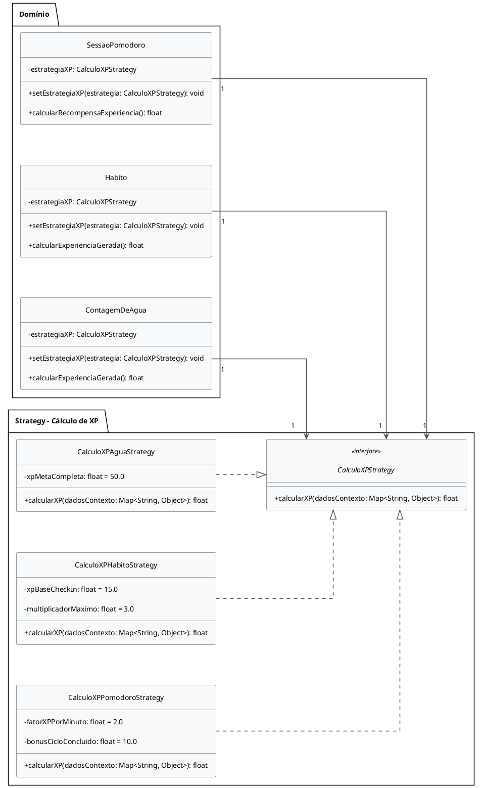

# Subgrupo 03 — Padrões Comportamentais

<div class="delivery-lead">
  <strong>Entrega 03 · Subgrupo 03 · Padrões Comportamentais</strong>
  <p>Roteiro de preenchimento do FOCO_03: padrão GoF Comportamental e uso crítico de IA generativa.</p>
</div>

<div class="members-grid" aria-label="Integrantes do Subgrupo 03">
  <a class="member-card" href="https://github.com/artmendess" target="_blank">
        
        <strong>Arthur Mendes Borges</strong>
        <span>241010914</span>
        <small>@artmendess</small>
      </a>
  <a class="member-card" href="https://github.com/vevetin" target="_blank">
        
        <strong>Weverton Rodrigues da Costa Silva</strong>
        <span>221022767</span>
        <small>@vevetin</small>
      </a>
  <a class="member-card" href="https://github.com/Pabloo8" target="_blank">
        
        <strong>Pablo Cunha de Jesus</strong>
        <span>222014910</span>
        <small>@Pabloo8</small>
      </a>
</div>

## Índice

* [Metodologia do Foco_03](#metodologia-do-foco_03)
* [GoF Comportamental](#gof-comportamental)
  * [Observer](#observer)
  * [State](#state)
  * [Strategy](#strategy)
  * [Memento](#memento)
  * [Rastreabilidade do padrão](#rastreabilidade-do-padrão)
* [IA Generativa](#ia-generativa)
* [Referências](#referências)
* [Versionamentos](#versionamentos)

---

## Focos do Relatório:
### FOCO_03: GoFs Comportamentais & IA Generativa

### Metodologia do Foco_03

O desenvolvimento do presente foco iniciou-se partir do modelo estático da Entrega 02 ([Diagrama de Classes da SubEquipe 03](https://unbarqdsw2026-2-turma02.github.io/2026.2-T02-_G4_ProjetoJogo_Entrega_02/#/Base/Relat%C3%B3rios/1.1.3.SubEquipe_03?id=modelo-est%c3%a1tico)), tomando como referência a literatura sobre Padrões de Projeto Comportamentais GoF (*Gang of Four*) ([GAMMA et al., 1994; SHVETS, 2021](../Relatórios/1.1.3.SubEquipe_03.md#referências)) e as orientações da disciplina ([SERRANO, 2026](../Relatórios/1.1.3.SubEquipe_03.md#referências)). O trabalho envolveu a análise de requisitos, a modelagem em UML e a implementação em Java, com revisões ao longo do processo para manter a correspondência entre as estruturas propostas e o comportamento esperado do sistema.

#### 1. Análise de requisitos e identificação dos padrões

A equipe analisou o Diagrama de Classes da Entrega 02 para identificar pontos em que a aplicação de padrões comportamentais poderia reduzir o acoplamento entre componentes e organizar responsabilidades. Essa análise resultou na *Proposta de Padrões GoF Comportamentais*, que considerou quatro padrões:

- **Observer:** notificação da conclusão de atividades, como sessões Pomodoro, hábitos e acompanhamento da hidratação, para atualizar o `PetVirtual` e o gerenciamento de conquistas.
- **State:** organização das transições da `SessaoPomodoro`, incluindo configuração, foco, pausas e conclusão, e das fases de vida do `PetVirtual`.
- **Strategy:** separação das fórmulas de cálculo de experiência (XP), permitindo variar a estratégia conforme a categoria da atividade.
- **Memento:** captura e restauração do estado do `PetVirtual`, com o propósito de preservar informações por meio de *snapshots*.

A análise serviu para comparar alternativas de organização do comportamento do sistema e definir as estruturas que seriam modeladas.

#### 2. Prototipação em PlantUML e ferramentas de apoio

A prototipação dos diagramas foi feita em PlantUML. Weverton Rodrigues iniciou a modelagem dos padrões Observer e State, enquanto Pablo Cunha ficou responsável pelo Strategy e Arthur Mendes, pelo Memento.

O NotebookLM foi utilizado para consultar materiais da disciplina, incluindo slides e vídeos da professora (SERRANO, 2026), e o livro *Dive Into Design Patterns* ([SHVETS, 2021](../Relatórios/1.1.3.SubEquipe_03.md#referências)). As consultas ajudaram a esclarecer dúvidas sobre os participantes e as responsabilidades de cada padrão.

O ChatGPT foi empregado para resolver dúvidas pontuais sobre a sintaxe do PlantUML e a disposição dos elementos nos diagramas. As sugestões foram revisadas pela equipe, que corrigiu estruturas incompatíveis com os requisitos e as abstrações do sistema.

Também foram consultadas a documentação do portal *UML Diagrams* ([UML-DIAGRAMS.ORG, c2009-2026](../Relatórios/1.1.3.SubEquipe_03.md#referências)) e a documentação do PlantUML para esclarecer a representação dos relacionamentos e a notação utilizada.

#### 3. Organização do subgrupo e divisão de responsabilidades

Após a elaboração inicial dos modelos, o subgrupo realizou reuniões de alinhamento e distribuiu as tarefas por meio de comunicação assíncrona ([SUBGRUPO 03, 2026b](../Relatórios/1.1.3.SubEquipe_03.md#referências)). As responsabilidades foram divididas entre modelagem, especificação, documentação e suporte à integração dos artefatos.

- **Weverton Rodrigues:** modelagem em PlantUML, refatoração e documentação dos padrões Observer e State.
- **Pablo Cunha:** modelagem em PlantUML, especificação e documentação do padrão Strategy.
- **Arthur Mendes:** modelagem em PlantUML, especificação e documentação do padrão Memento.
- **Todos:** suporte técnico, revisão do código-fonte em Java e integração das evidências referentes aos padrões desenvolvidos.

A equipe revisou os modelos desenvolvidos por cada integrante para manter a coerência entre os padrões e a arquitetura do sistema.

#### 4. Refinamento arquitetural dos diagramas

Durante a revisão dos diagramas preliminares, a equipe percebeu que a inclusão de todas as classes de domínio e seus atributos dificultava a leitura dos padrões. Por isso, os modelos foram revisados para concentrar as informações nas interfaces, abstrações e classes diretamente envolvidas em cada estrutura comportamental.

As classes de domínio necessárias para compreender a aplicação dos padrões foram mantidas. As demais foram retiradas dos diagramas para reduzir o excesso de informações e facilitar a identificação dos participantes, das relações de delegação e das responsabilidades de cada componente.

#### 5. Implementação em Java e rastreabilidade

Após a revisão dos diagramas PlantUML, a equipe iniciou a implementação em Java. Os modelos serviram de referência para a criação das interfaces, classes abstratas e classes concretas, buscando manter a correspondência entre os participantes dos padrões e suas responsabilidades no código.

A organização em pacotes como `observer`, `state`, `atividades` e `dominio` separou os mecanismos de notificação e controle de estados das entidades de domínio.

Os artefatos de modelagem e implementação foram reunidos para documentar a aplicação dos padrões e relacioná-los aos requisitos do sistema. As atas, os arquivos PlantUML, o código-fonte e os registros de execução devem ser apresentados nas respectivas seções do relatório, de modo que seja possível acompanhar as decisões tomadas e verificar a correspondência entre os modelos e a implementação.

**Evidências:** as atas de reuniões, o histórico de mensagens, as gravações das sessões de trabalho e os arquivos de modelagem e implementação estão disponíveis na seção de [Evidências da SubEquipe_03](../Evidências/1.1.3.SubEquipe_03.md).

### GoF Comportamental

### Observer

##### Contexto (Problema)

No utilitário gamificado de produtividade e acompanhamento de rotinas, a conclusão de atividades, como finalizar uma sessão na SessaoPomodoro, realizar o check-in diário de um Habito ou registrar o consumo de água em ContagemDeAgua, deve atualizar outros módulos do sistema. Entre eles estão o PetVirtual, que recebe experiência (XP), e o GerenciadorConquistas, responsável por verificar o cumprimento de metas.

Se cada classe de atividade precisasse chamar diretamente as operações do pet e do gerenciador de conquistas, haveria um acoplamento forte entre esses componentes. A inclusão de novos módulos para acompanhar o progresso, como um ranking semanal ou um histórico de atividades, também exigiria alterações nas classes existentes.

Para evitar essas dependências, foi adotado o padrão comportamental Observer (GoF). A proposta é estabelecer um mecanismo de publicação e assinatura (Publisher/Subscriber), no qual a atividade concluída emite um evento, representado por EventoConclusaoAtividade. Os observadores inscritos recebem a notificação e executam suas próprias ações, sem que a atividade precise conhecer suas implementações concretas.

##### Modelagem (Notação UML)

A modelagem do Observer foi feita em PlantUML e revisada para destacar os participantes do padrão e suas responsabilidades na notificação de atividades concluídas. O diagrama apresenta a estrutura de publicação e assinatura, separando o mecanismo de notificação das demais regras de negócio.

<center>

<p style={{ textAlign: 'center', fontSize: '18px' }}><b>Figura 1</b> - Diagrama de classes do padrão Observer</p>


<p style={{ textAlign: 'center', fontSize: '17px' }}>Autor: Weverton Rodrigues</p>

</center>

##### Implementação (Código & Vídeo com Padrão em Execução)

O padrão Observer foi implementado em Java, com as classes organizadas em pacotes para separar suas responsabilidades. O desenvolvimento do código teve como referência o material da disciplina, na literatura GoF e nos guias de implementação técnica disponíveis online ([GAMMA et al., 1995; REFACTORING.GURU, [s.d.]a; SERRANO, 2026; TUTORIALSPOINT, [s.d.]a](../Relatórios/1.1.3.SubEquipe_03.md#referências)).

As referências orientaram a definição da interface `ObservadorAtividade` e a estrutura da classe `AssuntoAtividade`, responsável por manter a lista de observadores e notificá-los quando uma atividade é concluída.

<!-- tabs:start -->

<!-- tab:CategoriaXP.java -->
```java
package dominio;

public enum CategoriaXP {
    INTELECTUAL,
    SABEDORIA,
    ZEN,
    ATLETICO,
    HIDRATACAO
}
```

<!-- tab:ObservadorAtividade.java -->

```java
package observer;

public interface ObservadorAtividade {
    void emAtividadeConcluida(EventoConclusaoAtividade evento);
}
```

<!-- tab:AssuntoAtividade.java -->
```java
package observer;

import java.util.ArrayList;
import java.util.List;

public abstract class AssuntoAtividade {

    private final List<ObservadorAtividade> observadores =
            new ArrayList<>();

    public void adicionarObservador(ObservadorAtividade obs) {
        if (obs != null && !observadores.contains(obs)) {
            observadores.add(obs);
        }
    }

    public void removerObservador(ObservadorAtividade obs) {
        observadores.remove(obs);
    }

    protected void notificarObservadores(
            EventoConclusaoAtividade evento) {

        List<ObservadorAtividade> copia =
                new ArrayList<>(observadores);

        for (ObservadorAtividade observador : copia) {
            observador.emAtividadeConcluida(evento);
        }
    }
}
```

<!-- tab:EventoConclusaoAtividade.java -->
```java
package observer;

import dominio.CategoriaXP;

public class EventoConclusaoAtividade {

    private final CategoriaXP categoria;
    private final float xpGerado;

    public EventoConclusaoAtividade(
            CategoriaXP categoria,
            float xpGerado) {

        this.categoria = categoria;
        this.xpGerado = xpGerado;
    }

    public CategoriaXP getCategoria() {
        return categoria;
    }

    public float getXPGerado() {
        return xpGerado;
    }
}
```

<!-- tab:GerenciadorConquistas.java -->
```java
package observer;

public class GerenciadorConquistas
        implements ObservadorAtividade {

    @Override
    public void emAtividadeConcluida(
            EventoConclusaoAtividade evento) {

        System.out.println(
                "[Gerenciador de conquistas] evento capturado."
        );

        System.out.println(" -> Categoria: " + evento.getCategoria() + " | XP Gerado: " + evento.getXPGerado()); 
        
        System.out.println(" -> Verificando requisitos para concessão de conquistas...");
    }
}
```

    <!-- tab:PetVirtual.java -->
    ```java
package dominio;

import observer.EventoConclusaoAtividade;
import observer.ObservadorAtividade;

public class PetVirtual implements ObservadorAtividade {

    private float experienciaTotal = 0.0f;

    @Override
    public void emAtividadeConcluida(
            EventoConclusaoAtividade evento) {
        System.out.println("[PetVirtual] Reagindo à notificação da atividade...");
        acumularExperiencia(
                evento.getCategoria(),
                evento.getXPGerado()
        );
    }

    public void acumularExperiencia(
            CategoriaXP categoria,
            float pontos) {

        this.experienciaTotal += pontos;

        System.out.println(" -> + " + pontos + " XP acumulados na categoria " + categoria + "."); 
        
        System.out.println(" -> Experiência Total do Pet: " + experienciaTotal + " XP.");
    }
}
```

<!-- tab:SessaoPomodoro.java -->

```java
package atividades;

import dominio.CategoriaXP;
import observer.AssuntoAtividade;
import observer.EventoConclusaoAtividade;

public class SessaoPomodoro extends AssuntoAtividade {

    private final CategoriaXP tagCategoria;

    public SessaoPomodoro(CategoriaXP tagCategoria) {
        this.tagCategoria = tagCategoria;
    }

    public void finalizarCicloComSucesso() {
        System.out.println("\n[SessaoPomodoro] Ciclo de foco concluído com êxito!"); 
        float xpGerado = 50.0f;

        EventoConclusaoAtividade evento =
                new EventoConclusaoAtividade(
                        this.tagCategoria,
                        xpGerado
                );

        notificarObservadores(evento);
    }
}
```

<!-- tab:Main.java -->
```java
package app;

import atividades.SessaoPomodoro;
import dominio.CategoriaXP;
import dominio.PetVirtual;
import observer.GerenciadorConquistas;

public class Main {

    public static void main(String[] args) {

        SessaoPomodoro sessao =
                new SessaoPomodoro(CategoriaXP.INTELECTUAL);

        PetVirtual pet = new PetVirtual();

        GerenciadorConquistas gerenciador =
                new GerenciadorConquistas();

        sessao.adicionarObservador(pet);
        sessao.adicionarObservador(gerenciador);

        System.out.println("Finalizando ciclo Pomodoro...");

        sessao.finalizarCicloComSucesso();

        sessao.removerObservador(gerenciador);
    }
}
```

<!-- tabs:end -->

###### Execução do Observer

O vídeo a seguir apresenta a execução inicial do projeto, de 0:00 a 1:56.

 [Link da gravação](https://www.youtube.com/watch?v=XfRaN6RchuE)

  <iframe
  width="560"
  height="315"
  src="https://www.youtube.com/embed/XfRaN6RchuE?start=0&end=116"
  title="Padrões em Execução - Observer e State (G4 - Jogo) - Trecho 1"
  frameborder="0"
  allow="accelerometer; autoplay; clipboard-write; encrypted-media; gyroscope; picture-in-picture; web-share"
  allowfullscreen>
</iframe>

### State

##### Contexto (Problema)

Na aplicação, duas entidades têm comportamentos que mudam conforme seu estado atual: a `SessaoPomodoro`, que passa pelas etapas de configuração, foco, pausa e conclusão, e o `PetVirtual`, que evolui pelas fases de bebê, criança, adolescente e adulto.

Sem uma estrutura para organizar essas mudanças, seria necessário espalhar condicionais (`if/else` ou `switch/case`) pelos métodos que controlam a sessão e o desenvolvimento do pet. Com isso, as classes de contexto acumulariam regras de diferentes estados, tornando a manutenção mais difícil e a inclusão de novos comportamentos dependente de alterações no código existente.

Para organizar essa lógica, foi adotado o padrão comportamental **State (GoF)**. Cada estado é representado por uma classe própria, responsável pelas ações e transições que lhe correspondem. As classes de contexto (`SessaoPomodoro` e `PetVirtual`) mantêm uma referência ao estado ativo (`estadoAtual`) e delegam a execução das operações a ele. Assim, as regras de cada etapa ficam separadas, e novos estados podem ser adicionados sem concentrar toda a lógica nas classes de contexto.

##### Modelagem (Notação UML)

A modelagem do padrão State foi elaborada em PlantUML para representar os participantes do padrão e suas relações nos dois módulos do sistema: o ciclo Pomodoro e a evolução do pet virtual.

Em ambos, as classes de contexto mantêm uma referência ao estado atual e delegam as operações às classes de estado concretas. Cada uma implementa o comportamento correspondente à etapa em que o objeto se encontra e define as transições para os demais estados.

<center>

<p style={{ textAlign: 'center', fontSize: '18px' }}><b>Figura 2</b> - Diagrama de classes do padrão State</p>


<p style={{ textAlign: 'center', fontSize: '17px' }}>Autor: Weverton Rodrigues</p>

</center>

##### Implementação (Código & Vídeo com Padrão em Execução)

O padrão State foi implementado em Java, com classes organizadas nos pacotes `pomodoro` e `pet`, que correspondem aos dois módulos do sistema. O desenvolvimento seguiu como referência o material da disciplina ([SERRANO, 2026](../Relatórios/1.1.3.SubEquipe_03.md#referências)), a literatura GoF ([GAMMA et al., 1995](../Relatórios/1.1.3.SubEquipe_03.md#referências)) e os guias do Refactoring.Guru ([REFACTORING.GURU, [s.d.]b](../Relatórios/1.1.3.SubEquipe_03.md#referências)) e do Tutorialspoint ([TUTORIALSPOINT, [s.d.]b](../Relatórios/1.1.3.SubEquipe_03.md#referências)).

Essas referências serviram de base para definir as interfaces de estado `EstadoPomodoro` e `EstadoPet`. A implementação também utiliza métodos `default` para reduzir a repetição de código e delega os comportamentos às classes de contexto `SessaoPomodoro` e `PetVirtual`, que controlam as transições entre estados.

<!-- tabs:start -->

<!-- tab:CategoriaXP.java -->
```java
package dominio;

public enum CategoriaXP {
    INTELECTUAL,
    SABEDORIA,
    ZEN,
    ATLETICO,
    HIDRATACAO
}
``` 

<!-- tab:EstadoPomodoro.java -->
```java
package state.pomodoro;

import atividades.SessaoPomodoro;

public interface EstadoPomodoro {

    default void iniciarCiclo(SessaoPomodoro sessao) {
        throw new IllegalStateException(
                "Não é possível iniciar o ciclo neste estado."
        );
    }

    default void pausarCiclo(SessaoPomodoro sessao) {
        throw new IllegalStateException(
                "Não é possível pausar o ciclo neste estado."
        );
    }

    default void retomarCiclo(SessaoPomodoro sessao) {
        throw new IllegalStateException(
                "Não é possível retomar o ciclo neste estado."
        );
    }

    default void finalizarCicloComSucesso(SessaoPomodoro sessao) {
        throw new IllegalStateException(
                "Não é possível finalizar o ciclo neste estado."
        );
    }
}
``` 

<!-- tab:EstadoConfigurando.java -->
```java
package state.pomodoro;

import atividades.SessaoPomodoro;

public class EstadoConfigurando implements EstadoPomodoro {

    @Override
    public void iniciarCiclo(SessaoPomodoro sessao) {
        System.out.println("[State Configurando] Iniciando ciclo de foco... Transicionando para 'Foco em Andamento'.");

        sessao.setEstado(new PomodoroFocoEmAndamento());
    }
}
``` 

<!-- tab:PomodoroFocoEmAndamento.java -->
```java
package state.pomodoro;

import atividades.SessaoPomodoro;

public class PomodoroFocoEmAndamento implements EstadoPomodoro {

    @Override
    public void pausarCiclo(SessaoPomodoro sessao) {
        System.out.println("[State FocoEmAndamento] Pausando o foco... Transicionando para 'Pausado'.");

        sessao.setEstado(new PomodoroPausado());
    }

    @Override
    public void finalizarCicloComSucesso(SessaoPomodoro sessao) {
        System.out.println("[State FocoEmAndamento] Ciclo concluído com êxito! Transicionando para 'Concluído'.");

        sessao.setEstado(new PomodoroConcluido());
    }
}
``` 

<!-- tab:PomodoroPausado.java -->
```java
package state.pomodoro;

import atividades.SessaoPomodoro;

public class PomodoroPausado implements EstadoPomodoro {

    @Override
    public void retomarCiclo(SessaoPomodoro sessao) {
        System.out.println("[State Pausado] Retomando ciclo de foco... Transicionando para 'Foco em Andamento'.");

        sessao.setEstado(new PomodoroFocoEmAndamento());
    }
}
``` 

<!-- tab:PomodoroConcluido.java -->
```java
public class PomodoroConcluido implements EstadoPomodoro {
    @Override 
    public void iniciarCiclo(SessaoPomodoro sessao) {
      System.out.println("[State Concluído] Reiniciando nova configuração de ciclo... Transicionando para 'Configurando'.");

      sessao.setEstado(new EstadoConfigurando());
  }
}
``` 

<!-- tab:SessaoPomodoro.java -->
```java
package atividades;

import state.pomodoro.EstadoPomodoro;
import state.pomodoro.EstadoConfigurando;

public class SessaoPomodoro {

    private EstadoPomodoro estadoAtual;

    public SessaoPomodoro() {
        this.estadoAtual = new EstadoConfigurando();
    }

    public void setEstado(EstadoPomodoro novoEstado) {
        if (novoEstado == null) {
            throw new IllegalArgumentException(
                    "O estado não pode ser nulo."
            );
        }

        this.estadoAtual = novoEstado;
    }

    public void iniciarCiclo() {
        estadoAtual.iniciarCiclo(this);
    }

    public void pausarCiclo() {
        estadoAtual.pausarCiclo(this);
    }

    public void retomarCiclo() {
        estadoAtual.retomarCiclo(this);
    }

    public void finalizarCicloComSucesso() {
        estadoAtual.finalizarCicloComSucesso(this);
    }
}
``` 

<!-- tab:EstadoPet.java -->
```java
package state.pet;

import dominio.CategoriaXP;
import dominio.PetVirtual;

public interface EstadoPet {

    void processarExperiencia(
            PetVirtual pet,
            CategoriaXP categoria,
            float pontos
    );

    void avaliarEvolucao(PetVirtual pet);
}
``` 

<!-- tab:EstadoBebe.java -->
```java
package state.pet;

import dominio.CategoriaXP;
import dominio.PetVirtual;

public class EstadoBebe implements EstadoPet {

    @Override
    public void processarExperiencia(
            PetVirtual pet,
            CategoriaXP categoria,
            float pontos) {
        System.out.println("[Fase Bebê] Processando " + pontos + " XP na categoria " + categoria + ".");

        avaliarEvolucao(pet);
    }

    @Override
    public void avaliarEvolucao(PetVirtual pet) {

        if (pet.getExperienciaTotal() >= 100.0f) {
            System.out.println("[EVOLUÇÃO!] Pet acumulou " + pet.getExperienciaTotal() + " XP e evoluiu de BEBÊ para CRIANÇA!");

            pet.setEstado(new EstadoCrianca());
        }
    }
}
``` 

<!-- tab:EstadoCrianca.java -->
```java
package state.pet;

import dominio.CategoriaXP;
import dominio.PetVirtual;

public class EstadoCrianca implements EstadoPet {

    @Override
    public void processarExperiencia(
            PetVirtual pet,
            CategoriaXP categoria,
            float pontos) {

        System.out.println("[Fase Criança] Processando " + pontos + " XP na categoria " + categoria + ".");

        avaliarEvolucao(pet);
    }

    @Override
    public void avaliarEvolucao(PetVirtual pet) {

        if (pet.getExperienciaTotal() >= 300.0f) {
            System.out.println("[EVOLUÇÃO!] Pet acumulou " + pet.getExperienciaTotal() + " XP e evoluiu de CRIANÇA para ADOLESCENTE!");

            pet.setEstado(new EstadoAdolescente());
        }
    }
}
``` 

<!-- tab:EstadoAdolescente.java -->
```java
package state.pet;

import dominio.CategoriaXP;
import dominio.PetVirtual;

public class EstadoAdolescente implements EstadoPet {

    private static final float XP_PARA_EVOLUIR = 600.0f;

    @Override
    public void processarExperiencia(
            PetVirtual pet,
            CategoriaXP categoria,
            float pontos) {
        System.out.println("[Fase Adolescente] Processando " + pontos + " XP na categoria " + categoria + ".");

        avaliarEvolucao(pet);
    }

    @Override
    public void avaliarEvolucao(PetVirtual pet) {

        if (pet.getExperienciaTotal() >= XP_PARA_EVOLUIR) {
            System.out.println("[EVOLUÇÃO!] Pet acumulou " + pet.getExperienciaTotal() + " XP e evoluiu de ADOLESCENTE para ADULTO!");

            pet.setEstado(new EstadoAdulto());
        }
    }
}
``` 

<!-- tab:EstadoAdulto.java -->
```java
package state.pet;

import dominio.CategoriaXP;
import dominio.PetVirtual;

public class EstadoAdulto implements EstadoPet {

    @Override
    public void processarExperiencia(
            PetVirtual pet,
            CategoriaXP categoria,
            float pontos) {
        System.out.println("[Fase Adulto] Processando " + pontos + " XP na categoria " + categoria + " (Nível Máximo Atingido).");

        avaliarEvolucao(pet);
    }

    @Override
    public void avaliarEvolucao(PetVirtual pet) {
        System.out.println(" -> Pet já se encontra em sua fase adulta máxima.");
    }
}
``` 

<!-- tab:PetVirtual.java -->
```java
package dominio;

import state.pet.EstadoPet;
import state.pet.EstadoBebe;

public class PetVirtual {

    private EstadoPet estadoAtual;

    private float experienciaTotal = 0.0f;

    public PetVirtual() {
        this.estadoAtual = new EstadoBebe();
    }

    public void setEstado(EstadoPet novoEstado) {
        if (novoEstado == null) {
            throw new IllegalArgumentException(
                    "O estado não pode ser nulo."
            );
        }

        this.estadoAtual = novoEstado;
    }

    public void acumularExperiencia(
            CategoriaXP categoria,
            float pontos) {

        if (categoria == null) {
            throw new IllegalArgumentException(
                    "A categoria não pode ser nula."
            );
        }

        if (pontos < 0) {
            throw new IllegalArgumentException(
                    "A experiência não pode ser negativa."
            );
        }
        
        this.experienciaTotal+= pontos;
        estadoAtual.processarExperiencia(this, categoria, pontos);
    }

    public float getExperienciaTotal() {
        return experienciaTotal;
    }
}
``` 

<!-- tab:Main.java -->
```java
package app;

import atividades.SessaoPomodoro;
import dominio.CategoriaXP;
import dominio.PetVirtual;

public class Main {

    public static void main(String[] args) {

        // Teste do State - Pomodoro
        SessaoPomodoro sessao = new SessaoPomodoro();

        sessao.iniciarCiclo();
        sessao.pausarCiclo();
        sessao.retomarCiclo();
        sessao.finalizarCicloComSucesso();

        System.out.println();

        // Teste do State - Pet Virtual
        PetVirtual pet = new PetVirtual();

        pet.acumularExperiencia(CategoriaXP.INTELECTUAL, 50.0f);
        pet.acumularExperiencia(CategoriaXP.ZEN, 60.0f);
        pet.acumularExperiencia(CategoriaXP.ATLETICO, 200.0f);
        pet.acumularExperiencia(CategoriaXP.SABEDORIA, 300.0f);
    }
}
``` 

<!-- tabs:end -->

###### Execução do State

O vídeo a seguir apresenta a continuação da execução, de 1:57 a 4:38, até o encerramento da demonstração.

 [Link da gravação](https://www.youtube.com/watch?v=XfRaN6RchuE)

  <iframe
  width="560"
  height="315"
  src="https://www.youtube.com/embed/XfRaN6RchuE?start=117&end=278"
  title="Padrões em Execução - Observer e State (G4 - Jogo) - Trecho 2"
  frameborder="0"
  allow="accelerometer; autoplay; clipboard-write; encrypted-media; gyroscope; picture-in-picture; web-share"
  allowfullscreen>
</iframe>

### Strategy

##### Contexto (Problema)

No utilitário gamificado de produtividade e acompanhamento de rotinas, a conclusão de diferentes tipos de atividades — como finalizar um ciclo de foco na SessaoPomodoro, realizar o check-in diário de um Habito ou registrar o consumo de água em ContagemDeAgua — resulta na geração de pontos de experiência (XP). 
No entanto, cada modalidade de atividade possui uma lógica e uma fórmula de pontuação totalmente distintas: o ciclo Pomodoro calcula a experiência com base no tempo focado e nos ciclos concluídos, os hábitos aplicam multiplicadores progressivos conforme a sequência de dias mantida (\*streak\*), e o registro de água pontua de acordo com o volume consumido e o percentual da meta diária alcançado.

Se os algoritmos de cálculo fossem codificados diretamente dentro das classes de cada atividade ou estruturados por meio de condicionais rígidas, qualquer alteração no balanceamento do jogo, ajuste de fórmulas ou criação de regras dinâmicas (como eventos temporários de "XP em dobro") exigiria a modificação direta do código-fonte das entidades de domínio. Essa abordagem aumentaria o acoplamento, violando o princípio Aberto/Fechado (OCP) e o princípio de Responsabilidade Única (SRP), além de dificultar a manutenção do sistema.
 
Para resolver essa rigidez, foi adotado o padrão comportamental **Strategy (GoF)**. A solução isola cada algoritmo de pontuação em classes de estratégia separadas (`CalculoXPPomodoroStrategy`, `CalculoXPHabitoStrategy`, `CalculoXPAguaStrategy`), que implementam a interface comum `CalculoXPStrategy`. A classe abstrata de contexto (`AssuntoAtividade\`) mantém uma referência para essa interface e delega a execução do cálculo a ela. Dessa forma, as fórmulas de cálculo de XP tornam-se intercambiáveis e independentes, permitindo alterar ou adicionar novas estratégias de pontuação em tempo de execução sem modificar as classes de atividade existentes.


##### Modelagem (Notação UML)
Apresentar a modelagem (seja estática; seja dinâmica), na notação UML.

<p style={{ textAlign: 'center', fontSize: '18px' }}><b>Figura 1</b> - Diagrama de classes do padrão Observer</p>



<p style={{ textAlign: 'center', fontSize: '17px' }}>Autor: Pablo Cunha</p>


##### Implementação (Código & Vídeo com Padrão em Execução)

A implementação do padrão Strategy foi estruturada separando as regras matemáticas no pacote `strategy` e mantendo as classes que sofrem a ação no pacote `dominio`. A implementação seguiu os conceitos apresentados nos materiais da disciplina e na literatura técnica. 

As classes de domínio recebem a estratégia via injeção de dependência (`setEstrategiaXP`), montam um `Map` com as informações de contexto (como minutos focados ou dias de *streak*) e repassam para o método `calcularXP` da interface resolver.

<!-- tabs:start -->

<!-- tab:Main.java -->
```java
package app;

import strategy.*;
import dominio.*;

public class Main {
    public static void main(String[] args) {
        System.out.println("=== EXECUÇÃO INDIVIDUAL: PADRÃO STRATEGY ===\n");

        CalculoXPStrategy regraAgua = new CalculoXPAguaStrategy();
        CalculoXPStrategy regraHabito = new CalculoXPHabitoStrategy();
        CalculoXPStrategy regraPomodoro = new CalculoXPPomodoroStrategy();

        ContagemDeAgua agua = new ContagemDeAgua();
        agua.setEstrategiaXP(regraAgua);
        System.out.println("-> XP Água (100%): " + agua.calcularExperienciaGerada());

        Habito leitura = new Habito();
        leitura.setEstrategiaXP(regraHabito);
        System.out.println("-> XP Hábito (Streak 3): " + leitura.calcularExperienciaGerada());

        SessaoPomodoro estudo = new SessaoPomodoro();
        estudo.setEstrategiaXP(regraPomodoro);
        System.out.println("-> XP Pomodoro (25 min + Conclusão): " + estudo.calcularRecompensaExperiencia());
    }
}
```

<!-- tab:ContagemDeAgua.java -->

```java
import strategy.CalculoXPStrategy;
import java.util.HashMap;
import java.util.Map;

public class ContagemDeAgua {
    private CalculoXPStrategy estrategiaXP;

    public void setEstrategiaXP(CalculoXPStrategy estrategia) {
        this.estrategiaXP = estrategia;
    }

    public float calcularExperienciaGerada() {
        if (estrategiaXP == null) return 0.0f;
        
        Map<String, Object> contexto = new HashMap<>();
        contexto.put("percentual", 1.0f); 
        
        return estrategiaXP.calcularXP(contexto);
    }
}
```

<!-- tab:Habito.java -->

```java
package dominio;

import strategy.CalculoXPStrategy;
import java.util.HashMap;
import java.util.Map;

public class Habito {
    private CalculoXPStrategy estrategiaXP;

    public void setEstrategiaXP(CalculoXPStrategy estrategia) {
        this.estrategiaXP = estrategia;
    }

    public float calcularExperienciaGerada() {
        if (estrategiaXP == null) return 0.0f;
        
        Map<String, Object> contexto = new HashMap<>();
        contexto.put("streak", 3); 
        
        return estrategiaXP.calcularXP(contexto);
    }
}
```

<!-- tab:SessaoPomodoro.java -->

```java
package dominio;

import strategy.CalculoXPStrategy;
import java.util.HashMap;
import java.util.Map;

public class SessaoPomodoro {
    private CalculoXPStrategy estrategiaXP;

    public void setEstrategiaXP(CalculoXPStrategy estrategia) {
        this.estrategiaXP = estrategia;
    }

    public float calcularRecompensaExperiencia() {
        if (estrategiaXP == null) return 0.0f;
        
        Map<String, Object> contexto = new HashMap<>();
        contexto.put("minutosFocados", 25); 
        contexto.put("foiConcluida", true); 
        
        return estrategiaXP.calcularXP(contexto);
    }
}
```

<!-- tab:CalculoXPAguaStrategy.java -->

```java
package strategy;

import java.util.Map;

public class CalculoXPAguaStrategy implements CalculoXPStrategy {
    private float xpMetaCompleta = 50.0f;

    @Override
    public float calcularXP(Map<String, Object> dadosContexto) {
        float percentual = (float) dadosContexto.getOrDefault("percentual", 1.0f);
        return xpMetaCompleta * percentual;
    }
}
```

<!-- tab:CalculoXPPomodoroStrategy.java -->

```java
package strategy;

import java.util.Map;

public class CalculoXPPomodoroStrategy implements CalculoXPStrategy {
    private float fatorXPPorMinuto = 2.0f;
    private float bonusCicloConcluido = 10.0f;

    @Override
    public float calcularXP(Map<String, Object> dadosContexto) {
        int minutosFocados = (int) dadosContexto.getOrDefault("minutosFocados", 0);
        boolean cicloConcluido = (boolean) dadosContexto.getOrDefault("foiConcluida", false);
        
        float xp = minutosFocados * fatorXPPorMinuto;
        if (cicloConcluido) {
            xp += bonusCicloConcluido;
        }
        return xp;
    }
}
```

<!-- tab:CalculoXPStrategy.java -->

```java


package strategy;

import java.util.Map;

public interface CalculoXPStrategy {
    float calcularXP(Map<String, Object> dadosContexto);
}
```

<!-- tab:CalculoXPHabitoStrategy.java -->
```java

package strategy;

import java.util.Map;

public class CalculoXPHabitoStrategy implements CalculoXPStrategy {
    private float xpBaseCheckIn = 15.0f;
    private float multiplicadorMaximo = 3.0f;

    @Override
    public float calcularXP(Map<String, Object> dadosContexto) {
        int streak = (int) dadosContexto.getOrDefault("streak", 1);
        float multiplicador = Math.min(1.0f + (streak * 0.1f), multiplicadorMaximo);
        return xpBaseCheckIn * multiplicador;
    }
}
```
<!-- tabs:end -->

###### Execução do Strategy

O vídeo a seguir demonstra a execução do padrão Strategy, explicando o problema das múltiplas regras de pontuação e demonstrando como os algoritmos de cálculo foram encapsulados e injetados nas classes do sistema para retornar o XP correto no terminal.

[Link da gravação](https://youtu.be/J37uwh8uWPc)

<iframe
  width="560"
  height="315"
  src="https://www.youtube.com/embed/J37uwh8uWPc"
  title="Padrões em Execução - Strategy (G4 - Jogo)"
  frameborder="0"
  allow="accelerometer; autoplay; clipboard-write; encrypted-media; gyroscope; picture-in-picture; web-share"
  allowfullscreen>
</iframe>

### Memento

##### Contexto (Problema)

Descrever o contexto, apresentando o problema a ser resolvido com o padrão deseajado.

<div class="fill-slot"><strong>Contexto e decisão</strong><p>Inserir problema do projeto, padrão selecionado, justificativa e relação com requisitos ou artefatos existentes.</p></div>

##### Modelagem (Notação UML)
Apresentar a modelagem (seja estática; seja dinâmica), na notação UML.

<div class="evidence-slot"><strong>Modelo UML</strong><p>Inserir diagrama, legenda e fonte. Relacionar os participantes do padrão às classes ou aos fluxos do projeto.</p></div>

#### Rastreabilidade do padrão

| Requisito ou problema | Decisão e papel do padrão | Modelo UML | Código | Evidência de execução |
|---|---|---|---|---|
| A preencher | A preencher | A preencher | A preencher | A preencher |

### IA Generativa

#### Participantes no Foco_03

| Nome do Membro | Lições Aprendidas | Uso da IA Generativa (SENSO CRÍTICO) |
|---|---|---|
| Arthur Mendes Borges | A preencher | A preencher |
| Pablo Cunha de Jesus | A preencher | A preencher |
| Weverton Rodrigues | Aprendi mais sobre os padrões Observer e State ao implementá-los em Java. Durante o trabalho, participei da análise dos diagramas, da elaboração dos modelos em PlantUML e da implementação do código. A prática me ajudou a entender melhor como esses padrões organizam o comportamento do sistema e como podem tornar o código mais fácil de manter. | Nesta entrega, percebi que a IA Generativa foi mais útil na criação de diagramas ao utilizar PlantUML (Diagrams as Code) do que gerando imagens. Como os LLMs lidam com sintaxe, código e estruturas lógicas formais, consegui utilizá-los para prototipar os diagramas e ajustar a modelagem dos padrões Observer e State. Ainda assim, as sugestões nem sempre estavam corretas. Consultei o material da disciplina e a literatura GoF para verificar os diagramas e corrigir inconsistências, como cardinalidades e papéis dos participantes dos padrões. Essa experiência reforçou a importância de avaliar criticamente as respostas da IA, em vez de aceitá-las sem revisão. |

### Referências

- GAMMA, Erich; HELM, Richard; JOHNSON, Ralph; VLISSIDES, John. Design patterns: elements of reusable object-oriented software. Reading: Addison-Wesley, 1995.

- PLANTUML. PlantUML: documentação. [S. l.], [s. d.]. Disponível em: https://plantuml.com/. Acesso em: 16 out. 2026.

- REFACTORING.GURU. Observer Pattern. Refactoring.Guru, [s.d.]a. Disponível em: https://refactoring.guru/design-patterns/observer. Acesso em: 10 out. 2026.

- REFACTORING.GURU. State Pattern. Refactoring.Guru, [s.d.]b. Disponível em: https://refactoring.guru/design-patterns/state. Acesso em: 10 out. 2026.

- SERRANO, Milene. Aula - GoFs Comportamentais. Brasília: Universidade de Brasília, 2026. Material didático da disciplina Arquitetura e Desenho de Software.

- SHVETS, Alexander. Dive into design patterns. [S. l.]: Refactoring.Guru, 2021. Disponível em: https://refactoring.guru/design-patterns/book. Acesso em: 10 out. 2026.

- TUTORIALSPOINT. Design Patterns - Observer Pattern. TutorialsPoint, [s.d.]a. Disponível em: https://www.tutorialspoint.com/design_pattern/observer_pattern.htm. Acesso em: 10 out. 2026.

- TUTORIALSPOINT. Design Patterns - State Pattern. TutorialsPoint, [s.d.]b. Disponível em: https://www.tutorialspoint.com/design_pattern/state_pattern.htm. Acesso em: 10 out. 2026.

- UML-DIAGRAMS.ORG. The Unified Modeling Language. c2009-2026. Disponível em: https://www.uml-diagrams.org/. Acesso em: 16 set. 2026.


<!-- Orientações originais de versionamento preservadas no código-fonte:
## Versionamentos
> |Nome do Membro | Contribuição | Data

> EXEMPLO:
> | Fulano  |  1. Elaboração do Padrão de Projeto GoF Comportamental Observer, com modelagem em UML, código e execução & Ponto de Vista sobre o Uso de IA Generativa | XX/XX/XXXX

| Nome do Membro | Contribuição | Data | Comprobatório |
|---|---|---|---|
| A preencher | A preencher | A preencher | A preencher |

OBS: TODOS DEVEM PARTICIPAR, MOSTRANDO SEUS PONTOS DE VISTA E COMO COLABORARAM NA ENTREGA.
-->

## Versionamentos

| Data | Nome do Membro | Contribuição | Comprobatórios (commits e links) |
|---|---|---|---|
| 18/10/2026 | [Weverton Rodrigues](https://github.com/vevetin) | Elaboração da seção Metodologia e documentação dos padrões Observer e State, incluindo diagramas UML e implementação em Java. | [commit 74ef7e2](https://github.com/UnBArqDsw2026-2-Turma02/2026.2-T02-_G4_ProjetoJogo_Entrega_03/commit/74ef7e212a6814d6a8cbf87c9ef014cf74d721d0) |
| 18/10/2026 | [Weverton Rodrigues](https://github.com/vevetin) | Adiciona videos dos padrões Observer e State em execução.  | [commit 8b8638a](https://github.com/UnBArqDsw2026-2-Turma02/2026.2-T02-_G4_ProjetoJogo_Entrega_03/commit/8b8638a4509b9a0e97637ed40bd0591836927ea1) |
| 18/10/2026 | [Weverton Rodrigues](https://github.com/vevetin) | Adiciona participação no Foco 3 - Uso da IA Generativa |  |
| 18/10/2026 | [Pablo Cunha](https://github.com/Pabloo8) | Documentação do Padrão Strategy, incluindo diagramas UML e implementação em Java. |  |

<!-- Orientações gerais do roteiro original preservadas sem exibição no relatório:
---
## Observações:
Entregável: Relatório, documentado no GitPages, revelando:
## Entrega Mínima: um subgrupo com um GoF Criacional (modelo & código & vídeo com o padrão em execução), um subgrupo em um GoF Estrutural (modelo & código & vídeo com o padrão em execução), um subgrupo com um GoF Comportamental (modelo & código & vídeo com o padrão em execução) e pontos de vista de cada membro da equipe sobre as lições aprendidas e uso da IA Generativa. Mira-se no MM, com a entrega mínima.

## Como ir além, para conseguir menções superiores?
Embasar cada artefato gerado e cada decisão tomada na literatura;
Manter rastros claros para o trabalho em equipe (ex. vídeos das reuniões e atas bem elaboradas), evidenciando práticas metodológicas (ex. reuniões periódicas das metodologias ágeis; checklists; debates, e assim vai);
Modelo & Código & Padrão Rodando bem esclarecidos, e
Reportar os pontos de vista de forma fundamentada, clara e com senso crítico.

## 📌A ideia não é quantidade, e sim qualidade do que é entregue.

## Apresentação:
Apresentação (para a professora) explicando o artefato elaborado, com: (i) rastro claro aos membros participantes (MOSTRAR QUADRO DE PARTICIPAÇÕES & COMMITS); (ii) justificativas & senso crítico sobre o trabalho realizado, e (iii) comentários gerais sobre o trabalho em equipe. Tempo da Apresentação: +/- 10min. Recomendação: Apresentar diretamente via Wiki ou GitPages do Projeto. Baixar os conteúdos com antecedência, evitando problemas de internet no momento de exposição nas Dinâmicas de Avaliação.

A Wiki ou GitPages do Projeto deve conter, PARA CADA SUBGRUPO, um tópico dedicado ao relatório com a entrega mínima, versionamentos, referências, e demais detalhamentos gerados pela equipe nesse escopo.
Demais orientações disponíveis nas Diretrizes (vide Aprender3).Recomendação: Apresentar diretamente via Wiki ou GitPages do Projeto. Baixar os conteúdos com antecedência, evitando problemas de internet no momento de exposição nas Dinâmicas de Avaliação.

A Wiki ou GitPages do Projeto deve conter, PARA CADA SUBGRUPO, um tópico dedicado ao relatório com a entrega mínima, versionamentos, referências, e demais detalhamentos gerados pela equipe nesse escopo.
Demais orientações disponíveis nas Diretrizes (vide Aprender3).
-->
