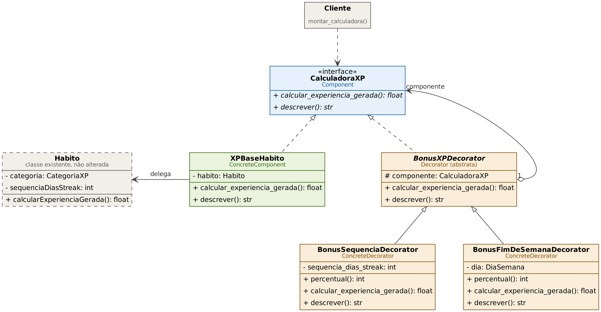
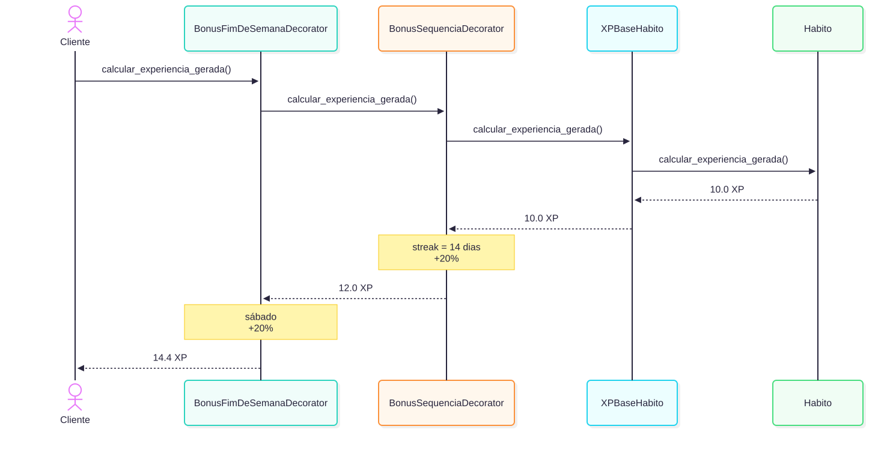
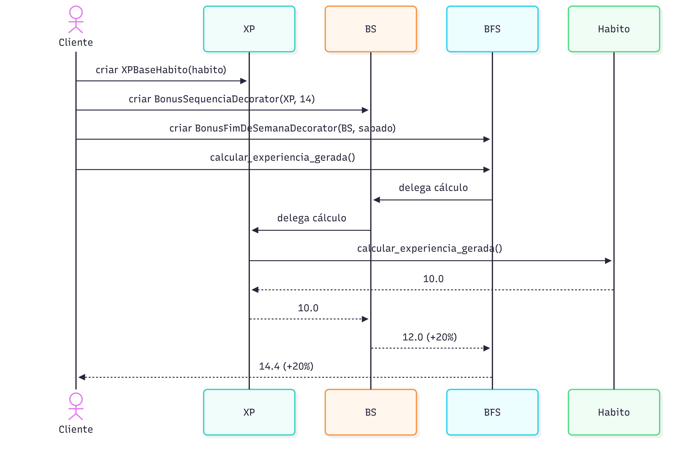

#### Metodologia do Foco_02

##### Objetivo e delimitação

Esta seção trata da aplicação do padrão GoF estrutural Decorator ao cálculo do XP gerado por um check-in de hábito. O escopo definido foi: bônus de XP aplicados em camadas sobre o XP base, como o bônus por sequência de dias e o bônus de fim de semana, em que cada decorator acrescenta um comportamento sem alterar a classe original e os bônus podem ser combinados livremente.

##### Processo de elaboração

A preparação foi organizada em etapas, separando o que já foi feito do que ainda está previsto:

| Etapa | Procedimento | Resultado e situação |
| --- | --- | --- |
| Compreensão do domínio | Consulta ao diagrama de classes da Entrega 02 (SubEquipe 03) e ao diagrama de estados do `Habito` . | Identificação de `Habito.calcularExperienciaGerada()`, de `sequenciaDiasStreak` e do enum `DiaSemana` como base dos dois bônus. Concluída. |
| Fundamentação | Consulta ao livro do GoF e a material de apoio sobre Decorator. | Caracterização do Decorator como alternativa à herança para estender comportamento. Concluída. A conferência da aula da disciplina e da dissertação listadas nas referências gerais do subgrupo está pendente. |
| Delimitação | Escolha de uma demonstração independente, com `Habito` simplificado e valores ilustrativos para os bônus. | Recorte definido. Os percentuais ainda devem ser confirmados com a equipe. |
| Modelagem estática | Definição dos participantes do padrão e de suas relações com `Habito`. | Diagrama de classes (Figura 1). |
| Modelagem dinâmica | Ordenação das chamadas ao longo da pilha de decorators. | Diagrama de sequência (Figura 2 e Figura 3). |
| Revisão da modelagem | Conferência visual dos diagramas contra o código. | Dois defeitos de notação da primeira versão (agregação invertida e seta de delegação confusa) foram corrigidos. Modelo revisado. |
| Implementação | Implementar o recorte independente em Python e verificar os cenários. | Código e demonstração executados; nove testes passaram; a execução foi reconferida em 19/10/2026. |
| Evidências | Publicação dos arquivos e vínculo com modelo, execução e contribuição. | Código, demonstração, testes e UML disponíveis no [commit de Gabriel](https://github.com/UnBArqDsw2026-2-Turma02/2026.2-T02-_G4_ProjetoJogo_Entrega_03/commit/1e1fc79d82d2ef669e489ac52f0a5ce8ef77d425). Vídeo próprio do Decorator não apresentado. |


#### GoF Estrutural
##### Contexto (Problema)
O projeto é um jogo de pet virtual em que a rotina do usuário alimenta o desenvolvimento do pet. No diagrama de classes da Entrega 02 , `Habito` concentra o check-in diário: guarda a categoria (`CategoriaXP`), a sequência de dias (`sequenciaDiasStreak`) e os dias ativos (`diasAtivosSemana`), e expõe `calcularExperienciaGerada()`. O XP gerado é acumulado pelo `PetVirtual` por categoria, por meio de `acumularExperiencia()`.

O diagrama da Entrega 02 não prevê bônus de XP. Se o jogo premiar a constância e momentos específicos da semana, como o bônus por sequência de dias e o de fim de semana, o XP de um check-in deixa de ser um valor único e passa a depender de quais bônus se aplicam. Esses bônus podem ser combinados, e novos bônus podem surgir. Tratar cada combinação com condicionais dentro de `Habito`, ou com uma subclasse por combinação, faz o número de variações crescer rapidamente e obriga a alterar classes existentes a cada novo bônus.

Esse é um risco identificado na análise da modelagem, e não uma afirmação de que o problema já ocorreu em um jogo implementado.


##### Padrão selecionado e justificativa

A proposta é criar a interface `CalculadoraXP`, implementada pelo XP base (`XPBaseHabito`) e por decoradores de bônus (`BonusSequenciaDecorator` e `BonusFimDeSemanaDecorator`). O cliente monta a pilha de camadas que deseja e consulta o resultado final por `calcular_experiencia_gerada()`.

O GoF descreve o Decorator como o padrão que anexa responsabilidades adicionais a um objeto de forma dinâmica, como alternativa flexível à herança para estender funcionalidade . O decorator implementa a mesma interface do objeto que embrulha, delega a chamada a ele e pode ajustar o resultado antes ou depois, de modo que o cliente trata o objeto decorado e o original da mesma maneira e pode empilhar várias camadas . As responsabilidades acrescentadas também podem ser retiradas . Neste projeto, o princípio é aplicado aos bônus de XP.

A escolha se sustenta em três aspectos:

- **Combinação livre em tempo de execução:** quais bônus valem depende da data do check-in e da sequência atual, e o cliente decide as camadas a cada cálculo.
- **Classe original preservada:** `Habito` continua responsável apenas pelo XP base; os bônus ficam em classes próprias.
- **Extensibilidade:** um novo bônus é uma nova subclasse de `BonusXPDecorator`, sem alterar `Habito` nem os bônus existentes.

O padrão tem custos. A montagem das camadas fica no cliente e cresce com o número de bônus. Remover uma camada específica do meio da pilha é trabalhoso, e a ordem das camadas pode alterar o resultado quando o comportamento de uma depende do que a anterior fez . Neste recorte, os dois bônus são percentuais multiplicativos, e por isso a ordem não altera o valor final (há teste para isso). Um bônus de valor fixo exigiria definir a ordem. Criar classes com sufixo Decorator, sem a mesma interface e sem delegação ao componente embrulhado, não caracteriza adequadamente a aplicação do padrão.


##### Alternativas consideradas

| Alternativa | Avaliação para este problema |
| --- | --- |
| Condicionais dentro de `Habito` | Basta para dois bônus, mas cada novo bônus exige alterar `Habito`, que já reúne o estado do check-in, a sequência e o congelamento. |
| Uma subclasse por combinação | Com *n* bônus independentes há 2ⁿ combinações (4 para dois bônus, 32 para cinco). A herança é fixada antes da execução, e aqui a combinação muda a cada check-in . |
| Strategy | Troca o algoritmo inteiro por dentro do objeto. Aqui o cálculo base permanece e se quer acrescentar efeitos sobre o resultado dele . |
| Adapter | Resolve incompatibilidade entre interfaces. Não há incompatibilidade aqui, e o Decorator mantém ou estende a interface do objeto . |
| Chain of Responsibility | Tem estrutura parecida, mas os elos podem interromper a cadeia; os decoradores não interrompem o fluxo da chamada . |
| Facade | Oferece uma entrada simples para uma operação que coordena subsistemas. Aqui o objetivo é estender o resultado de um cálculo, e não coordenar subsistemas. |
| Decorator | Cada bônus é uma camada pequena com uma só responsabilidade, a combinação é escolhida pelo cliente e `Habito` não muda. |

##### Escopo, premissas e decisões

- A pilha de decoradores calcula o XP final de um check-in que já aconteceu. Ela **não registra o check-in, não atualiza a sequência de dias e não acumula XP no pet**; essas responsabilidades continuam em `registrarCheckInDiario()` e em `PetVirtual.acumularExperiencia()` .
- A sequência de dias usada é a informada pelo cliente no momento da montagem da pilha. Se o check-in do próprio dia já conta na sequência é uma decisão do fluxo de check-in, a ser alinhada com a equipe.
- A data do check-in é recebida como `date`. Fuso horário não é tratado neste recorte.
- Os valores são ilustrativos: XP base de 10,0, +10% a cada 7 dias de sequência (teto de +50%) e +20% no sábado e no domingo. Eles devem ser confirmados com quem define o balanceamento do jogo.
- Os bônus valem para qualquer `CategoriaXP`. Regras específicas por categoria ficam fora do escopo.
- O mesmo contrato poderia envolver outras atividades que calculam experiência, como `ContagemDeAgua.calcularExperienciaGerada()` e `SessaoPomodoro.calcularRecompensaExperiencia()` . A demonstração cobre apenas `Habito`.
- O congelamento e a quebra de streak, descritos no diagrama de estados do `Habito`, não participam deste recorte.

##### Modelagem (Notação UML)

###### Diagrama de classes



**Figura 1.** Participantes e relações do Decorator aplicado aos bônus de XP. Fonte: modelagem de Gabriel Pereira da Silva, registrada no commit `1e1fc79`.

O diagrama é um recorte: `Habito` exibe apenas os membros que participam do fluxo. `CategoriaXP` e `DiaSemana` são os tipos enumerados já existentes. O diagrama da Entrega 02 usa *camelCase* e o código Python usa *snake_case*; `calcularExperienciaGerada()` do diagrama corresponde a `calcular_experiencia_gerada()` no código.

| Participante do padrão | Elemento do projeto | Responsabilidade |
| --- | --- | --- |
| Component | `CalculadoraXP` | Interface comum: tudo que calcula XP responde a `calcular_experiencia_gerada()` e `descrever()`. |
| ConcreteComponent | `XPBaseHabito` | Fornecer o XP base do check-in, delegando ao `Habito`. |
| Decorator | `BonusXPDecorator` | Guardar o componente embrulhado e delegar a ele por padrão. |
| ConcreteDecorator | `BonusSequenciaDecorator` | Aplicar o bônus por sequência de dias. |
| ConcreteDecorator | `BonusFimDeSemanaDecorator` | Aplicar o bônus de sábado e domingo. |
| Cliente | `montar_calculadora()` e `demo.py` | Escolher e empilhar as camadas e consultar o resultado. |
| Classe existente | `Habito` | Calcular o XP base; não é alterada pelo padrão. |

**Legenda UML:** `+` indica visibilidade pública; `-`, privada; `#`, protegida. Linha tracejada com triângulo vazado indica realização de interface; linha contínua com triângulo vazado, herança; losango vazado, agregação (o decorator possui um `CalculadoraXP`, que pode ser o componente base ou outro decorator); linha contínua com seta, associação navegável; linha tracejada com seta, dependência. Texto em itálico indica elemento abstrato e borda tracejada indica classe já existente, não alterada. Os rótulos Component, ConcreteComponent, Decorator e ConcreteDecorator identificam papéis do padrão.

###### Diagrama de sequência





**Figuras 2 e 3.** Delegação ao longo das camadas e retorno do cálculo. Fonte: modelagem de Gabriel Pereira da Silva, registrada no commit `1e1fc79`.

**Leitura do fluxo:** o cliente chama a camada mais externa (fim de semana), que repassa a chamada à camada de sequência, que a repassa ao XP base, que consulta o `Habito` e obtém 10,0. Na volta, cada camada ajusta o valor: a sequência de 14 dias acrescenta 20% (12,0) e o fim de semana acrescenta mais 20% (14,4). O cliente enxerga apenas `CalculadoraXP`.

A ordem de empilhamento é escolha do cliente; neste exemplo, a sequência fica por dentro e o fim de semana por fora. Como os dois bônus são percentuais multiplicativos, a ordem inversa leva ao mesmo valor final, e apenas o texto de `descrever()` muda de ordem. O diagrama mostra o caminho de um cálculo e não inclui o registro do check-in nem o acúmulo de XP no pet.

##### Implementação (Código & Vídeo com Padrão em Execução)
A implementação em Python corresponde ao recorte independente do UML. O exemplo usa uma versão simplificada de `Habito`, que mantém o título, a categoria, a sequência de dias e um XP base ilustrativo, e não depende dos códigos de Adapter ou Facade.

###### Interface comum (Component)

```python
class CalculadoraXP(ABC):
    """Interface comum a quem calcula XP: o componente base e todos os decorators."""

    @abstractmethod
    def calcular_experiencia_gerada(self) -> float:
        ...

    @abstractmethod
    def descrever(self) -> str:
        """Texto com as camadas aplicadas (útil para tela de resumo e para depurar)."""
```

Define o contrato comum. O restante do jogo enxerga o cálculo de XP por essa interface, sem saber quantas camadas existem. `descrever()` devolve o texto das camadas aplicadas e serve para depurar e para a demonstração.

###### XP base (ConcreteComponent)

```python
class XPBaseHabito(CalculadoraXP):
    """XP base do check-in: delega ao Habito, sem nenhum bônus."""

    def __init__(self, habito: Habito) -> None:
        self._habito = habito

    def calcular_experiencia_gerada(self) -> float:
        return self._habito.calcular_experiencia_gerada()
```

É o objeto que fica no centro da pilha. Apenas delega ao `Habito`, que continua intacto: o padrão não exige alterar a classe original.

###### Camada base (Decorator)

```python
class BonusXPDecorator(CalculadoraXP):
    """Decorator base: implementa a mesma interface e delega tudo ao componente embrulhado."""

    def __init__(self, componente: CalculadoraXP) -> None:
        self._componente = componente

    def calcular_experiencia_gerada(self) -> float:
        return self._componente.calcular_experiencia_gerada()
```

Implementa a mesma interface e guarda uma referência a outro `CalculadoraXP`, que pode ser o componente base ou outro decorator. É essa referência que permite empilhar camadas. Por padrão apenas repassa a chamada; as subclasses acrescentam o comportamento.

###### Bônus de sequência (ConcreteDecorator)

```python
class BonusSequenciaDecorator(BonusXPDecorator):
    """+10% de XP a cada 7 dias de sequência (streak), com teto de +50%."""

    DIAS_POR_BLOCO = 7
    PERCENTUAL_POR_BLOCO = 10
    PERCENTUAL_MAXIMO = 50

    def __init__(self, componente: CalculadoraXP, sequencia_dias_streak: int) -> None:
        super().__init__(componente)
        self._sequencia_dias_streak = max(0, sequencia_dias_streak)

    def percentual(self) -> int:
        blocos = self._sequencia_dias_streak // self.DIAS_POR_BLOCO
        return min(blocos * self.PERCENTUAL_POR_BLOCO, self.PERCENTUAL_MAXIMO)

    def calcular_experiencia_gerada(self) -> float:
        xp_anterior = super().calcular_experiencia_gerada()
        return xp_anterior * (1 + self.percentual() / 100)
```

Pede o valor à camada de dentro e o multiplica pelo bônus. A sequência chega pelo construtor, e valores negativos são tratados como zero. O percentual usa aritmética inteira, o que evita erros de arredondamento na regra; o arredondamento aparece apenas na exibição do valor final.

###### Bônus de fim de semana (ConcreteDecorator)

```python
class BonusFimDeSemanaDecorator(BonusXPDecorator):
    """+20% de XP quando o check-in acontece no sábado ou no domingo."""

    PERCENTUAL = 20
    DIAS_COM_BONUS = frozenset({DiaSemana.SABADO, DiaSemana.DOMINGO})

    def __init__(self, componente: CalculadoraXP, data_checkin: date) -> None:
        super().__init__(componente)
        self._dia = DiaSemana.de_data(data_checkin)

    def percentual(self) -> int:
        return self.PERCENTUAL if self._dia in self.DIAS_COM_BONUS else 0

    def calcular_experiencia_gerada(self) -> float:
        xp_anterior = super().calcular_experiencia_gerada()
        return xp_anterior * (1 + self.percentual() / 100)
```

Segue a mesma estrutura, com outra regra: +20% quando o dia do check-in é sábado ou domingo. Usa o enum `DiaSemana`, espelhado do diagrama de classes. Uma camada pode estar presente e não ter efeito (+0%), como em um check-in de quarta-feira.

###### Montagem da pilha (Cliente)

```python
def montar_calculadora(
    habito: Habito,
    data_checkin: date,
    *,
    bonus_sequencia: bool = True,
    bonus_fim_de_semana: bool = True,
) -> CalculadoraXP:
    """O cliente decide quais camadas empilhar; quem usa o resultado só vê CalculadoraXP."""
    calculadora: CalculadoraXP = XPBaseHabito(habito)
    if bonus_sequencia:
        calculadora = BonusSequenciaDecorator(calculadora, habito.sequencia_dias_streak)
    if bonus_fim_de_semana:
        calculadora = BonusFimDeSemanaDecorator(calculadora, data_checkin)
    return calculadora
```

O cliente decide quais camadas empilhar. Quem recebe o resultado conhece apenas `CalculadoraXP`, e por isso tanto faz haver zero, uma ou duas camadas por fora. O `demo.py` percorre cenários que variam a sequência, a data e as camadas ativadas, e imprime o texto de `descrever()` e o XP final de cada um.

###### Regras ilustrativas e limites

Os valores de 10,0 de XP base, +10% por bloco de 7 dias (teto de +50%) e +20% no fim de semana são dados da demonstração, não uma fórmula de balanceamento aprovada. A sequência é lida no momento da montagem da pilha, e a data do check-in é recebida como `date`, sem tratamento de fuso horário. O congelamento e a quebra de streak não participam deste recorte.

Os dados ficam em memória. Não há persistência, concorrência nem integração com `PetVirtual.acumularExperiencia()`: o código mostra o padrão aplicado ao cálculo, e não o fluxo completo do check-in.

###### Execução e verificação

Na raiz do repositório, com Python 3:

```sh
python3 docs/Base/DiagramaDecorator/demo.py
python3 -m unittest discover -s docs/Base/DiagramaDecorator -p "test_*.py" -v
```

A execução foi verificada com Python 3.13.16 em 18/10/2026. A demonstração executou os cenários abaixo, e os nove testes passaram. Os testes verificam as faixas do bônus de sequência (inclusive o teto e a sequência negativa), sábado, domingo e dia útil, a combinação dos dois bônus, a independência da ordem das camadas, a ativação parcial de camadas e a garantia de que `Habito` não é alterado.

| Cenário demonstrado | Resultado observado |
| --- | --- |
| Dia útil, sequência de 2 dias | Nenhum bônus se aplica; XP final 10,00. |
| Dia útil, sequência de 7 dias | Sequência +10%; XP final 11,00. |
| Sábado, sequência de 2 dias | Fim de semana +20%; XP final 12,00. |
| Sábado, sequência de 14 dias | Sequência +20% e fim de semana +20%; XP final 14,40. |
| Sábado, sequência de 100 dias | Sequência no teto (+50%) e fim de semana +20%; XP final 18,00. |
| Sábado, sequência de 14 dias, camadas parciais | Só fim de semana: 12,00; só sequência: 12,00; nenhuma camada: 10,00. |
##### Rastreabilidade do padrão

| Requisito ou problema | Decisão e papel do padrão | Modelo UML | Código | Evidência de execução |
|---|---|---|---|---|
| Calcular o XP base de um check-in de hábito | Preservar o cálculo em `Habito`, acessado por `XPBaseHabito` | Figura 1: Component e ConcreteComponent | `Habito`, `XPBaseHabito` | Dia útil com sequência de 2 dias: 10,00 XP, conforme a demonstração |
| Bonificar sequência de dias sem alterar o hábito | Envolver o componente em `BonusSequenciaDecorator` | Figura 1 e fluxo das Figuras 2 e 3 | `BonusSequenciaDecorator` | Testes de faixas, teto de 50% e sequência negativa |
| Aplicar bônus no sábado e no domingo | Acrescentar `BonusFimDeSemanaDecorator` | Figura 1 e fluxo das Figuras 2 e 3 | `BonusFimDeSemanaDecorator` | Testes de sábado, domingo e dia útil |
| Combinar ou desativar bônus por cálculo | Montar as camadas pelo contrato `CalculadoraXP` | Figuras 1, 2 e 3 | `montar_calculadora()` e `demo.py` | Testes de combinação, ordem, ativação parcial e preservação do hábito |
