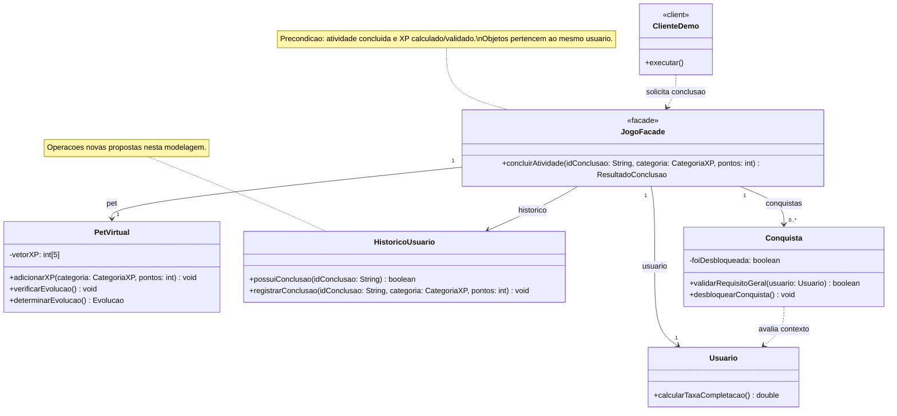

#### Metodologia do Foco_02

##### Objetivo e delimitação

Esta seção trata da aplicação independente do padrão GoF estrutural Facade ao fluxo de conclusão de atividades do jogo. O objetivo é oferecer ao cliente uma operação simples para coordenar experiência, evolução do pet, histórico e conquistas. A demonstração implementada não depende dos padrões Adapter e Decorator dos demais integrantes.

O responsável pela seção é Guilherme Negreiros Pereira, conforme a divisão registrada na página do Subgrupo 01. A organização do GitHub Pages permanece uma contribuição adicional e não substitui a modelagem, a implementação e a execução do Facade.

##### Processo de elaboração

A preparação foi organizada em etapas, separando os artefatos já elaborados das atividades ainda previstas:

| Etapa | Procedimento | Resultado e situação |
|---|---|---|
| Compreensão do domínio | Consulta aos relatórios das Entregas 01 e 02 e ao roteiro do Subgrupo 01 da Entrega 03. | Identificação do fluxo de recompensas e das classes existentes. |
| Fundamentação | Consulta à aula de Milene Serrano e à seção 5.10 da dissertação de Figueiredo. | Caracterização do Facade como interface simplificada para subsistemas. |
| Delimitação | Escolha de uma demonstração independente, recebendo dados de uma atividade já concluída. | Recorte definido por Guilherme. |
| Modelagem estática | Distribuição das responsabilidades entre cliente, fachada e subsistemas. | Diagrama de classes proposto nesta seção. |
| Modelagem dinâmica | Ordenação das chamadas e tratamento do reenvio da mesma conclusão. | Diagrama de sequência proposto nesta seção. |
| Revisão da modelagem | Análise e ajustes dos diagramas e das responsabilidades das classes por Guilherme. | Modelo revisado por Guilherme. |
| Implementação | Implementar o recorte independente em Python e verificar os cenários. | Código e demonstração executados; sete testes passaram. |
| Evidências | Gravar execução, publicar os arquivos e relacionar a contribuição ao commit. | Pendente. |

#### GoF Estrutural

##### Contexto (Problema)

O projeto combina pet virtual, Pomodoro e acompanhamento de hábitos saudáveis. Na Entrega 01, as ações de produtividade e autocuidado são relacionadas ao estado e ao desenvolvimento do pet [3]. Na Entrega 02, essa ideia aparece em classes como `PetVirtual`, `Usuario`, `HistoricoUsuario` e `Conquista`, além das atividades que calculam experiência [4].

Quando uma atividade é concluída, o jogo pode precisar adicionar XP à categoria correspondente, verificar a evolução do pet, registrar a conclusão e avaliar conquistas. Se cada cliente executar diretamente essa sequência, precisará conhecer as interfaces e a ordem das operações de vários objetos. A repetição pode provocar diferenças entre os fluxos: uma tela pode atualizar XP e esquecer o histórico, por exemplo.

Esse é um risco identificado na análise da modelagem, e não uma afirmação de que essas falhas já ocorreram em um jogo implementado.

##### Padrão selecionado e justificativa

A proposta é criar `JogoFacade`, com a operação pública `concluirAtividade(idConclusao, categoria, pontos)`. O cliente fornece os dados da conclusão, e a fachada coordena os objetos envolvidos.

Na aula de Milene Serrano, os padrões estruturais são associados à redução de acoplamento, e Facade é apresentado como uma interface simplificada de acesso a várias interfaces do sistema [1, páginas 6, 8 e 61 do PDF]. Figueiredo discute, em jogos, a utilização de uma fachada para reduzir a dependência entre a camada de interação e os componentes internos [2, seção 5.10]. Neste projeto, o princípio é aplicado ao fluxo de recompensas, em vez do exemplo gráfico utilizado pelo autor.

A escolha se sustenta em três aspectos:

- **Simplificação do cliente:** a solicitação do fluxo fica concentrada em uma operação, sem exigir que cada tela repita a coordenação dos subsistemas.
- **Localização da coordenação:** ajustes na sequência podem ser feitos na fachada, preservando uma entrada estável para o cliente.
- **Preservação das responsabilidades:** a fachada solicita ações; o pet continua responsável pela evolução, e as conquistas continuam responsáveis pelos próprios critérios.

A redução de acoplamento se refere ao cliente em relação aos subsistemas. A fachada passa a conhecê-los, e sua interface ainda pode precisar mudar caso o fluxo de negócio mude. Criar uma classe com nome Facade, sem oferecer simplificação e delegação, não caracteriza adequadamente a aplicação do padrão.

##### Alternativas consideradas

| Alternativa | Avaliação para este problema |
|---|---|
| Chamadas diretas em cada tela | Pode bastar para uma única demonstração curta, mas repete a coordenação quando existem vários clientes. |
| Colocar todo o fluxo em `PetVirtual` | Mistura a evolução do pet com registro de atividades e gestão de conquistas. |
| Colocar todo o fluxo em `Usuario` | Aumenta as responsabilidades de uma classe que já representa perfil e contexto do usuário. |
| Adapter | Resolve compatibilidade entre contratos; não é o problema central da coordenação deste recorte. |
| Decorator | Permite compor comportamentos adicionais; não é necessário para organizar as chamadas aos subsistemas. |
| Facade | Oferece uma entrada simples para a operação composta e mantém o comportamento nos responsáveis. |

##### Escopo, premissas e decisões

A operação representa o processamento das consequências de uma conclusão. Ela **não encerra o cronômetro nem marca o hábito como cumprido**: recebe uma ocorrência já concluída, com categoria e XP calculados e validados pela atividade. Essa premissa permite estudar Facade sem incorporar outros padrões.

O contrato de entrada inclui `idConclusao`, identificador de uma ocorrência específica. O mesmo hábito em dias diferentes tem conclusões diferentes. Categoria e pontos respeitam as restrições da Entrega 02: água usa HIDRATACAO; Pomodoro usa INTELECTUAL ou SABEDORIA. A fachada não estabelece as fórmulas de XP.

A fachada mantém referências ao usuário, ao pet, ao histórico e às conquistas desse mesmo usuário. O objeto `Usuario` é contexto para a avaliação de conquistas, preservando a operação `validarRequisitoGeral(usuario)` do modelo anterior. As referências são recebidas na montagem do exemplo; não se propõe que a fachada crie ou controle o ciclo de vida desses objetos.

No histórico são propostas `possuiConclusao()` e `registrarConclusao()`. Essas operações não constam no diagrama anterior e devem ser incorporadas de modo explícito na implementação desta demonstração. O registro mínimo contém identificador, categoria e pontos; métricas específicas como tempo de foco e volume de água exigirão ampliar o contrato se forem utilizadas por uma conquista.

O histórico é atualizado antes da avaliação das conquistas para que o contexto possa refletir a conclusão atual. A implementação deve garantir acesso aos mesmos objetos do usuário. A verificação de conclusão repetida é uma decisão complementar do exemplo, não uma exigência do padrão Facade.

##### Modelagem (Notação UML)

###### Diagrama de classes

<div class="state-diagram">
  
</div>

**Figura 1 — Facade aplicado ao processamento de uma atividade concluída.** Fonte: elaborado e revisado por Guilherme Negreiros Pereira, com base nas classes da Entrega 02 e na estrutura apresentada em [1] e [2]. A IA generativa foi utilizada como ferramenta de apoio à elaboração e à revisão.

O diagrama é um recorte: omite atributos e operações sem participação no fluxo. `CategoriaXP` e `Evolucao` são os tipos enumerados já existentes. `ResultadoConclusao` é um objeto de retorno proposto com a situação PROCESSADA ou JA_REGISTRADA e as novas conquistas. O tipo é referido na assinatura, sem uma caixa própria para manter o foco nos participantes do padrão.

| Participante do padrão | Elemento do projeto | Responsabilidade |
|---|---|---|
| Cliente | `ClienteDemo` | Simular uma tela solicitando o processamento pela fachada. |
| Fachada | `JogoFacade` | Coordenar a operação sem concentrar as fórmulas e critérios. |
| Subsistema | `PetVirtual` | Adicionar XP e verificar evolução. |
| Subsistema | `HistoricoUsuario` | Consultar e registrar ocorrências concluídas. |
| Subsistema | `Conquista` | Avaliar o usuário e desbloquear a conquista. |
| Contexto | `Usuario` | Fornecer o contexto de avaliação das conquistas. |

**Legenda UML:** `+` indica visibilidade pública; `-`, privada; linha contínua com seta indica associação navegável; linha tracejada com seta indica dependência; `1` e `0..*` indicam multiplicidades. Os rótulos `client` e `facade` identificam papéis do padrão. As associações não representam composição nem exigem herança. O desenho de `Conquista` com dependência de `Usuario` expressa o parâmetro utilizado em sua operação de avaliação.

<details>
<summary>Ver código Mermaid — diagrama de classes</summary>



</details>

<a href="Base/Diagramas/Facade/classes.mmd" target="_blank" rel="noopener">Abrir fonte Mermaid do diagrama de classes</a> · <a href="Base/Diagramas/Facade/classes.svg" target="_blank" rel="noopener">Abrir imagem vetorial</a>.

###### Diagrama de sequência

<div class="state-diagram">
  
</div>

<details>
<summary>Ver código Mermaid — diagrama de sequência</summary>

```mermaid
sequenceDiagram
    autonumber
    actor Cliente as Cliente de demonstracao
    participant F as JogoFacade
    participant P as PetVirtual
    participant H as HistoricoUsuario
    participant C as Conquista
    Note over Cliente,F: Atividade ja concluida; categoria e XP ja calculados e validados
    Cliente->>F: concluirAtividade(idConclusao, categoria, pontos)
    F->>H: possuiConclusao(idConclusao)
    H-->>F: registrada
    alt Conclusao ja registrada
        F-->>Cliente: ResultadoConclusao(JA_REGISTRADA)
    else Nova conclusao
        F->>P: adicionarXP(categoria, pontos)
        F->>P: verificarEvolucao()
        F->>H: registrarConclusao(idConclusao, categoria, pontos)
        loop Para cada conquista ainda bloqueada
            F->>C: validarRequisitoGeral(usuario)
            C-->>F: criterioAtendido
            opt Criterio atendido
                F->>C: desbloquearConquista()
            end
        end
        F-->>Cliente: ResultadoConclusao(PROCESSADA, novasConquistas)
    end
```

</details>

**Figura 2 — Sequência proposta para conclusão nova e reenvio.** Fonte: elaborado e revisado por Guilherme Negreiros Pereira, a partir do diagrama de classes, com a IA generativa como ferramenta de apoio à elaboração e à revisão. <a href="Base/Diagramas/Facade/sequencia.mmd" target="_blank" rel="noopener">Abrir fonte Mermaid</a> · <a href="Base/Diagramas/Facade/sequencia.svg" target="_blank" rel="noopener">Abrir imagem vetorial</a>.

**Leitura do fluxo:** a fachada consulta o histórico; uma ocorrência já registrada retorna sem nova recompensa. Para uma ocorrência nova, solicita XP e evolução ao pet, registra o evento e percorre as conquistas ainda bloqueadas. Cada conquista avalia seu critério com o usuário e é desbloqueada apenas se ele for atendido. O retorno informa o processamento e as novas conquistas.

A ordem é proposta para o caminho de sucesso de uma demonstração síncrona. O modelo não promete transações ou recuperação automática de falhas entre etapas. Esses mecanismos exigiriam decisões adicionais de persistência e consistência.

##### Implementação (Código & Vídeo com Padrão em Execução)
Explicar cada trecho de código, inerente aos participantes do padrão.
Conferir um link para o código hospedado no repositorio do projeto.
Acordar um vídeo, demonstrando o código em execução.

<!-- separador do roteiro original -->
<div class="fill-slot"><strong>Código e execução</strong><p>Inserir explicação dos trechos, link permanente para o código e vídeo do padrão em execução.</p></div>

##### Rastreabilidade do padrão

| Requisito ou problema | Decisão e papel do padrão | Modelo UML | Código | Evidência de execução |
|---|---|---|---|---|
| A preencher | A preencher | A preencher | A preencher | A preencher |

##### Referências utilizadas por Guilherme — Facade

1. SERRANO, Milene. **Arquitetura e Desenho de Software — Aula GoFs Estruturais**. Material da disciplina. Páginas 6, 8 e 61 do PDF. <a href="Base/Referencias/Aula_GoFs_Estruturais_Profa_Milene.pdf" target="_blank" rel="noopener">Consultar material</a>.
2. FIGUEIREDO, Roberto Tenorio. **Padrões de Projeto GoF aplicados ao Desenvolvimento de Jogos Eletrônicos**. Dissertação de mestrado, Universidade Federal de Pernambuco, 2014. Seção 5.10, páginas impressas 68–71 (páginas 70–73 do PDF). <a href="Base/Referencias/Dissertacao_Roberto_Tenorio_Figueiredo.pdf" target="_blank" rel="noopener">Consultar dissertação</a> · [Repositório UFPE](https://repositorio.ufpe.br/handle/123456789/11981).
3. EQUIPE G4. **Entrega 01 — Relatório da SubEquipe 03**. Contexto do pet virtual, produtividade e hábitos. [Consultar relatório](https://unbarqdsw2026-2-turma02.github.io/2026.2-T02-_G4_ProjetoJogo_Entrega_01/#/Base/Relat%C3%B3rios/1.1.3.SubEquipe_03).
4. EQUIPE G4. **Entrega 02 — Relatório da SubEquipe 01**. Modelagem estática e dinâmica. [Consultar relatório](https://unbarqdsw2026-2-turma02.github.io/2026.2-T02-_G4_ProjetoJogo_Entrega_02/#/Base/Relat%C3%B3rios/1.1.1.SubEquipe_01).
5. EQUIPE G4. **Entrega 03 — Subgrupo 01, FOCO_02**. Roteiro do relatório, responsáveis e entregáveis. [Consultar página do subgrupo](/Base/Relatórios/1.1.1.SubEquipe_01.md).
